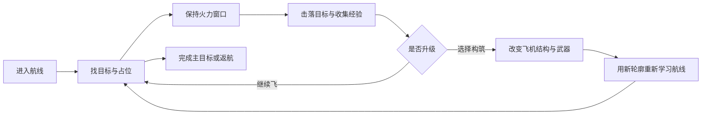

# 局内到底在玩什么

这份文档把《Knight on Air》的局内体验定义成一条可以反复验证的决策链。游戏的观感保持光遇式的轻松、柔和和治愈，局内行为围绕指尖皇牌空战展开。玩家持续驾驶一架可以生长和变形的飞机，在一条越来越危险的航线上完成目标。

## 核心体验

玩家每局反复处理四个问题。

1. 我现在应该把飞机放到哪里，才能把目标放进火力窗口。
2. 我需要继续暴露多久，才能完成击杀或投弹。
3. 我应该把经验换成更高质量的飞机性能，还是增加更多机翼、发动机和武器。
4. 当前构型出现偏航、滚转、受弹面积或能源压力后，我是否还能安全完成目标。

玩家的操作、敌人的成长和飞机的构筑都围绕空间位置产生结果。击落目标以后，玩家得到经验和构筑机会。构筑以后，飞机的轮廓和操控发生变化。新的轮廓又会改变下一段航线。



## 一局的节奏

### 进入航线

副本开场给玩家一段低压力飞行时间。玩家可以观察风向、云层、金币和第一个敌群，理解当前机体的速度、转向和自动武器范围。

### 建立火力窗口

敌机从不同方向进入，玩家需要通过航向、速度和提前量把目标留在机炮、导弹或炮塔的有效区间。火力窗口应该清晰，玩家能够理解自己为什么命中或落空。

### 处理目标压力

目标类型决定玩家要承担的风险。需要正面击毁的敌机要求持续输出，正在轰炸地面目标的敌机要求快速拦截，护航目标则要求玩家在目标附近持续清场。

### 选择构筑

升级不会把玩家从战斗里抽离太久。升级面板应该让玩家立即理解飞机会长出什么部件、性能会如何变化、代价会落在哪个维度。

### 用新构型完成目标

构筑后的飞机需要马上面对新的空间问题。长翼变得更容易受弹，更多发动机带来更大惯性，单侧武器可能带来滚转偏差。玩家在下一段航线上验证自己的选择。

## 副本目标

所有副本都共享主目标、敌群节奏、空间变化、构筑窗口和结束压力五个层次。主目标保证玩家始终知道应该击落谁，敌群节奏保证画面持续有事发生，空间变化让玩家持续改变航线，构筑窗口提供成长，结束压力让副本有清晰收束。

| 副本编排 | 主要目标 | 玩家要学会的东西 | 适合的构筑方向 |
| --- | --- | --- | --- |
| 清空空域 | 击落指定数量的敌机 | 目标切换、提前量和持续移动 | 转向、锁定、持续火力 |
| 击毁 Boss | 处理 Boss 阶段和护卫 | 找攻击窗口、短时暴露和脱离 | 单点爆发、导弹、机炮质量 |
| 轰炸目标 | 完成投弹并处理拦截 | 稳定准心、控制俯冲和回航 | 稳定性、炸弹舱、护航能力 |
| 保护目标 | 阻止敌人击中飞艇或专机 | 识别威胁、快速拦截和换位 | 速度、锁定距离、导弹数量 |
| 护送目标 | 让大型目标穿过航线 | 控制目标附近的战斗半径 | 范围火力、耐久、左右平衡 |

主目标应该始终通过颜色、标记和声音保持可读。普通击杀是构筑资源，主目标击杀是副本进度，两者在反馈上需要明确区分。

## 敌人成长曲线

敌人强度按照副本指定斜率增长。导演系统先计算一段时间内的威胁预算，再把预算转换成敌机数量、精英数量、生命、装甲、射击频率、攻击方向和弹幕密度。

```text
threatBudget(t) = startBudget + slope * floor(elapsedSeconds / 30)
```

威胁预算的变化需要控制在玩家能读懂的范围内。推荐先让每个三十秒段只提高一到两个主要维度，避免生命、数量和弹幕同时暴涨。Boss 副本可以把预算集中在阶段变化，护送副本可以把预算集中在进入方向和目标攻击压力。

玩家需要在副本开始前看到三个信息。

- 当前副本的基础威胁
- 当前副本的成长斜率
- 目标类型对应的主要压力

这样玩家能够判断自己当前的飞机适合提质、提量、轰炸或护航。

## 提质与提量

### 提质路线

提质路线提高飞机每个关键部位的效率。它让玩家更快、更稳、更容易进入火力窗口，适合依赖位置和操作的机体。

- 极速和加速度
- 转向速度和转向响应
- 能量上限与恢复
- 锁定时间和锁定弧
- 单发伤害和命中精度
- 受弹面积和碰撞半径

提质路线应该保持轮廓清晰。升级带来的变化可以是更紧凑的机身、更锐利的翼尖、更短的锁定时间和更明亮的尾焰。

### 提量路线

提量路线让飞机长出更多可以工作的部件。它让玩家获得更高的火力覆盖和更大的容错，同时承担质量、面积、惯性和能源压力。

- 机翼数量和翼展
- 发动机数量
- 机枪、机炮和炮塔数量
- 炸弹舱和挂点数量
- 装甲和分段生命
- 多方向的火力覆盖

提量路线要让玩家立即看到变化。八层机翼、十台发动机、左右不对称机枪和串列式挂点都应该来自明确的局部锚点，模型看起来夸张，结构关系仍然清楚。

## 飞机原型与构筑性格

| 目标原型 | 初始性格 | 推荐起手构筑 | 后期爆改方向 |
| --- | --- | --- | --- |
| 福克 Dr.I 三翼机 | 低速高转向，三层翼面 | 转向、能量、近距机枪 | 继续叠翼、增加翼根炮位 |
| Spitfire 喷火 | 高速单翼，机炮精度高 | 转向、锁定、机炮质量 | 椭圆翼尖、翼内多炮 |
| A6M 零式 | 轻量、大翼面、长续航 | 能量、转向、翼面积 | 低质量长翼、少量高质量武器 |
| Vampire 吸血鬼 | 喷气速度和加速度 | 极速、能量、喷口效率 | 双尾梁、串列翼、翼根武器 |
| Horten Ho 229 飞翼 | 翼面就是机身，空间扩张大 | 翼根发动机、火力密度 | 飞翼挂点复制、左右不对称、炮艇化 |

每个原型都需要保留一个清晰的最佳起手方向，同时允许玩家故意走向低效率构筑。高质量构筑带来稳定的成功率，奇怪构筑带来新的操控问题和更强的视觉记忆点。

## 模块骨架

飞机由一条或多条中心线组成。中心线是视觉、碰撞、武器挂点和构筑扩展共同使用的结构语言。

### 固定骨架

- 机身中心线
- 左右主翼根
- 尾段中心线
- 发动机中心线
- 座舱站位
- 机鼻和尾翼站位

### 可插入结构

- 机翼延长段
- 串列式机翼
- 翼根发动机
- 翼下发动机
- 翼尖发动机
- 机背炮塔
- 机腹炸弹舱
- 尾侧武器舱
- 装甲和散热器

### 操控反馈

左右侧的部件数量和质量需要传导到控制反馈。

- 左右翼发动机数量不同，产生滚转偏差
- 左右翼面积不同，产生升力差
- 单侧重武器增加偏航惯性
- 尾部挂舱改变转向响应
- 单边部件损坏后保留操控异常

所有三维模块都从现有 3D 内容库和局部锚点生成。模拟层保存部件和中心线数据，渲染层通过飞机工厂取得几何、材质和局部姿态。

## 三视图还原流程

原型飞机的还原顺序固定为参考筛选、外轮廓、架构、模块边缘、中心线、翼根、发动机、尾翼、武器和爆改层。

1. 先用 Wiki 三视图确认机长、翼展、机身最大宽度和主翼前后缘，并用照片补充体积和结构连接。
2. 确认飞机属于常规机身、双尾梁或飞翼架构，再确认座舱、发动机、翼根和尾翼在纵向中心线上的站位。
3. 对机身、每一层机翼、尾翼、发动机整流罩和起落架分别记录前缘、后缘、上下缘、根部接缝、翼尖和净距。
4. 将主翼、尾翼、发动机和起落架转成局部锚点与模块 profile。三层翼不能用统一的层间公式掩盖各层不同的前后、上下和翼展位置。
5. 用生成式模型重建正面、侧面和俯视轮廓，在原型校验台用“正视、侧视、俯视”按钮逐面切换。固定视角沿机体局部轴线设置，并关闭展示状态的自动滚转，同时查看 Wiki 三视图、程序化模型和中心线图。
6. 最后再叠加武器、装甲、炸弹舱和非对称爆改。

校验台记录各原型的投影来源和结构。喷火 Mk Vb 以 Marek Cel 的侧、俯视配合 Airwar 的 VB 正视，零式二一型以 A6M2 三视图配合制造号 500 实机照片。生成模型使用现有 `frameId` 作为运行时承载槽，后续可以把高偏差原型升级为独立的正式机体定义。

### 本轮三视图核对修正

| 原型 | 三视图暴露的偏差 | 当前程序化修正 |
| --- | --- | --- |
| Fokker Dr.I | 旧模型用统一层级公式，翼面后掠、翼组偏后，缺少下方起落架 | 三层翼改为独立边缘 profile，全部设为平直翼并前置到螺旋桨盘附近，上中下翼分别落在机身上缘、中心线和下缘，补入双支柱起落架 |
| Spitfire Mk Vb | 椭圆翼翼尖过厚，发动机与翼根关系不清 | 审核板分别描读双侧椭圆翼，模型按双侧均值生成主翼，保留右翼冷却液散热器、左翼滑油冷却器与空速管 |
| A6M2 二一型 | 主翼弦长过深，细长机身被翼面比例遮盖 | 审核板配准展开翼尖、主翼前后缘和机身中线，模型在展开的折叠缝两侧共用边界翼肋，只在左外翼装空速管 |
| de Havilland Vampire | 双尾梁过短且尾翼偏前，进气道没有站在翼根前缘 | 延长并后移双尾梁，提高尾翼，补入两侧进气道 |
| Horten Ho 229 | 被错误地按飞行艇生成，中心舱过长，尾缘控制面漂浮 | 改为 `integratedWing` 飞翼承载槽，缩短中心舱，发动机移到翼根，尾缘控制面沿连续翼面布置 |

## 设计验收标准

一个机型进入正式内容目录前，需要满足以下条件。

- 正视图能认出主翼高度、翼展和发动机左右关系
- 侧视图能认出机鼻、座舱、机身厚度和尾段长度
- 俯视图能认出主翼前后缘、尾翼和挂点方向
- 每个关键部件都有对应中心线和局部锚点
- 每个结构模块都有三视图边缘记录，层叠机翼和起落架的根部接缝可在正视图中读出
- 武器从真实挂点发射，发动机尾焰从真实出口生成
- 爆改件沿中心线插入，数量增加不会随机漂浮
- 左右不对称会反映到操控和受弹面积
- 机型的最佳构筑方向可以通过视觉和数值同时读懂
