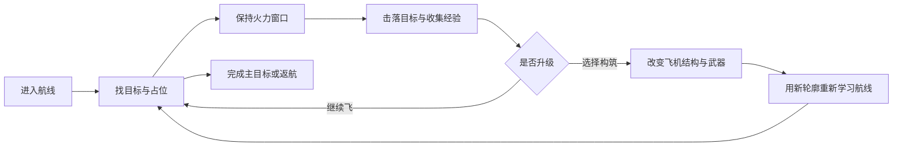

# 玩法与构筑设计

这份文档定义《Knight on Air · 云端骑士》的产品定位与局内核心体验决策链。具体的系统行为契约与验收场景见 [OpenSpec 战斗规格](../openspec/specs/battle/air-combat-behavior/spec.md)，机型三视图建模管线见 [真实机型三视图档案](aircraft-profiles/README.md)。

## 产品定位与目标平台

- **形态与视点**：移动端竖屏网页版 3D lowpoly 空战与对地轰炸游戏；使用透视相机与固定俯视角，控制逻辑运行在 XZ 平面，兼具 2.5D 操作清晰度与 3D 空间临场感。
- **单手操作**：面向手机右手单手短局游玩（每局 5–12 分钟碎片时间），竖屏设计尺寸覆盖 360×640 至 430×932 CSS 像素；桌面端提供键盘与侧栏辅助。
- **体验基调**：观感保持《光·遇》云野式的轻松、明媚与治愈，局内行为围绕指尖空战与自由构筑展开。玩家持续驾驶一架可以生长和变形的飞机，在越来越危险的航线上完成目标。
- **体验关键词**：轻快、低门槛、目标清晰、反馈强、越升级越有形、每局都有不同的构筑路线。

## 核心体验

玩家每局反复处理四个问题：

1. 我现在应该把飞机放到哪里，才能把目标放进火力窗口。
2. 我需要继续暴露多久，才能完成击杀或投弹。
3. 我应该把经验换成更高质量的飞机性能，还是增加更多机翼、发动机和武器。
4. 当前构型出现偏航、滚转、受弹面积或能源压力后，我是否还能安全完成目标。

玩家的操作、敌人的成长和飞机的构筑都围绕空间位置产生结果。击落目标以后，玩家得到经验和构筑机会。构筑以后，飞机的轮廓和操控发生变化。新的轮廓又会改变下一段航线。



## 一局的节奏

### 进入航线

副本开场给玩家一段低压力飞行时间。玩家可以观察风向、云层、金币和第一个敌群，理解当前机体的速度、转向和自动武器范围。

### 建立火力窗口

敌机从不同方向进入，玩家通过航向和速度把目标留在机炮、导弹或炮塔的有效区间。各武器在自身射界内预估提前量，辅助调整发射方向。火力窗口应该清晰，玩家能够理解自己为什么命中或落空。

### 处理目标压力

目标类型决定玩家要承担的风险。需要正面击毁的敌机要求持续输出，正在轰炸地面目标的敌机要求快速拦截，护航目标则要求玩家在目标附近持续清场。

### 选择构筑

局内改装保留上方战场和 HUD，在底部面板显示三项候选、本局金币余额和数值变化。选择候选仅生成展示构型。确认安装时重新验证资格和余额，一次性支付本局金币并消费一次升级。返回战斗可保留升级次数和候选，余额在结算时进入现有存档流程。[机体改装](../openspec/changes/improve-in-run-upgrade-experience/specs/battle/aircraft-refit/spec.md) · [局内成长](../openspec/changes/improve-in-run-upgrade-experience/specs/battle/in-run-progression/spec.md)

### 用新构型完成目标

构筑后的飞机需要马上面对新的空间问题。长翼变得更容易受弹，更多发动机带来更大惯性，单侧武器可能带来滚转偏差。玩家在下一段航线上验证自己的选择。

## 空战体验

玩家在巡航时遇到一个像真人飞行员一样争取位置的对手。敌机发现目标后，根据双方的位置、航向、速度和机体能力决定怎样接近。追猎角色驾驶性能与对局相称的飞机，可以主动转入玩家尾后。它在距离较远时争取闭合速度，接近射击位置后匹配速度。有射击机会时开火，玩家初次规避时尝试跟上。

玩家通过持续转弯、反向转弯或在合适时机加力破坏射击线。相对位置允许时，玩家可以从被追转为追击。敌机被反追时会根据威胁改变航向或速度，尝试甩开玩家或重新占位。玩家保住火力窗口，才有机会击落这架仍在机动的敌机。玩家应能从轨迹、射击和反馈中读出威胁来自哪里、自己的动作有没有奏效，以及何时适合反击。

这是一场代表性的交锋。双方的操作、机体性能和损伤会改变每次遭遇的过程与结果。导演负责生成时机、单位类型、编组、入口和预算。交锋中的接近、攻击、跟随、规避和重新占位由飞机自身的决策产生。[空战行为规格](../openspec/specs/battle/air-combat-behavior/spec.md) · [遭遇导演规格](../openspec/specs/battle/encounter-director/spec.md)

敌机的轮廓也提供决策信息。玩家从机翼布局、发动机数量和推进形式辨认机型，并从飞行轨迹和开火方式判断对手正在追猎、截击或掩护。作战飞机沿用校验台已有的同时代模型。损伤、脱落、开火和尾流跟随对应机体的部件。[时代内容与配置规范](CONTENT_CATALOG.md#敌机模型与飞行行为)

| 敌人职责 | 飞行员的选择 | 主要压力 | 玩家应对 |
| --- | --- | --- | --- |
| 追猎机 | 从可达方位主动争取尾后位置，受威胁时规避 | 持续跟随，争取再次开火 | 转弯、加力、反向追击 |
| 高速截击机 | 选择交会点，攻击后拉开距离 | 高速切入、开火、超越 | 预判航向、在其脱离时追击 |
| 俯冲攻击机 | 选择攻击轴，一次攻击后脱离 | 短时攻击和路线越线 | 提前占位、避开攻击轴 |
| 轰炸机与炮艇机 | 维持路线或区域攻击机会 | 攻击任务目标并迫使换位 | 优先拦截、保持火力窗口 |

### 分析与验收

- **追得上**。用当前关卡或自由巡航的实际机体与敌机配置，分别观察松杆直飞和轻推普通油门。记录距离随时间的变化、实际速度和首次开火时间。追猎机应在可交锋的时间内形成威胁。若距离无法缩短，同时查机体能达到的速度、追击时实际给出的油门以及敌人选择的路线。
- **跟得住，也甩得掉**。比较小幅修正、持续转弯和适时加力后的轨迹、射击机会和脱离原因。首个轻微动作后仍可感到威胁，有效规避能改变双方位置并争取反击机会。
- **被反追时会防御**。用同一架敌机验证攻守转换。玩家对准敌人后，观察它如何根据受威胁的方位、间距和机动余量改变动作，以及玩家能否通过继续追踪取得击落机会。
- **局内能读懂**。用固定种子对照双方轨迹、实际开火事件和控制输入，并通过竖屏试玩确认玩家能读出接近、失位和反击机会。状态序列用于定位具体决策，完整交锋用于判断体验是否达到目标。

## 副本目标

所有副本都共享主目标、敌群节奏、空间变化、构筑窗口和结束压力五个层次。主目标保证玩家始终知道应该击落谁，敌群节奏保证画面持续有事发生，空间变化让玩家持续改变航线，构筑窗口提供成长，结束压力让副本有清晰收束。

| 副本编排 | 主要目标 | 玩家要学会的东西 | 适合的构筑方向 |
| --- | --- | --- | --- |
| 清空空域 | 击落指定数量的敌机 | 目标切换、提前量和持续移动 | 转向、锁定、持续火力 |
| 击毁 Boss | 处理 Boss 阶段和护卫 | 找攻击窗口、短时暴露和脱离 | 单点爆发、导弹、机炮质量 |
| 轰炸目标 | 完成投弹并处理拦截 | 稳定准心、控制俯冲和回航 | 稳定性、炸弹舱、护航能力 |
| 保护目标 | 阻止敌人击中飞艇或专机 | 识别威胁、快速拦截和换位 | 速度、锁定距离、导弹数量 |
| 护送目标 | 让大型目标穿过航线 | 控制目标附近的战斗半径 | 范围火力、耐久、左右平衡 |

主目标应该始终通过颜色、标记和声音保持可读。普通击杀是构筑资源，主目标击杀是副本进度，两者在反馈上需要明确区分。

## 敌人成长曲线

敌人强度按照副本指定斜率增长。导演系统先计算一段时间内的威胁预算，再把预算转换成敌机数量、精英数量、生命、装甲、射击频率、攻击方向和弹幕密度。

```text
threatBudget(t) = startBudget + slope * floor(elapsedSeconds / 30)
```

威胁预算的变化需要控制在玩家能读懂的范围内。推荐先让每个三十秒段只提高一到两个主要维度，避免生命、数量和弹幕同时暴涨。Boss 副本可以把预算集中在阶段变化，护送副本可以把预算集中在进入方向和目标攻击压力。

玩家需要在副本开始前看到三个信息：

- 当前副本的基础威胁
- 当前副本的成长斜率
- 目标类型对应的主要压力

这样玩家能够判断自己当前的飞机适合提质、提量、轰炸或护航。

## 提质与提量

### 提质路线

提质路线提高飞机每个关键部位的效率。它让玩家更快、更稳、更容易进入火力窗口，适合依赖位置和操作的机体。

- 极速和加速度
- 转向速度和转向响应
- 能量上限与恢复
- 锁定时间和锁定弧
- 单发伤害和命中精度
- 受弹面积和碰撞半径

提质路线应该保持轮廓清晰。升级带来的变化可以是更紧凑的机身、更锐利的翼尖、更短的锁定时间和更明亮的尾焰。

### 提量路线

提量路线让飞机长出更多可以工作的部件。它让玩家获得更高的火力覆盖和更大的容错，同时承担质量、面积、惯性和能源压力。

- 机翼数量和翼展
- 发动机数量
- 机枪、机炮和炮塔数量
- 炸弹舱和挂点数量
- 装甲和分段生命
- 多方向的火力覆盖

提量路线要让玩家立即看到变化。多层机翼、多台发动机、左右不对称机枪和串列式挂点都应该来自明确的局部锚点，模型看起来夸张，结构关系仍然清楚。

数量型升级默认可叠加十层，机型可以按升级 ID 覆盖上限。同座双联与炮塔快转座各生效一次。福克 Dr.I 的左右下翼各可安装十个一米段，每段拥有独立机枪挂点、结构身份和生命状态。扩建段自带的武器容量与基础硬点一并计入总容量。[构型叠加](../openspec/changes/improve-in-run-upgrade-experience/specs/battle/aircraft-refit/spec.md#requirement-cumulative-structural-stacks)

## 飞机原型与构筑性格

| 目标原型 | 初始性格 | 推荐起手构筑 | 后期爆改方向 |
| --- | --- | --- | --- |
| 福克 Dr.I 三翼机 | 低速高转向，三层翼面 | 转向、能量、近距机枪 | 继续叠翼、增加翼根炮位 |
| Spitfire 喷火 | 高速单翼，机炮精度高 | 转向、锁定、机炮质量 | 椭圆翼尖、翼内多炮 |
| A6M 零式 | 轻量、大翼面、长续航 | 能量、转向、翼面积 | 低质量长翼、少量高质量武器 |
| Vampire 吸血鬼 | 喷气速度和加速度 | 极速、能量、喷口效率 | 双尾梁、串列翼、翼根武器 |
| Horten Ho 229 飞翼 | 翼面就是机身，空间扩张大 | 翼根发动机、火力密度 | 飞翼挂点复制、左右不对称、炮艇化 |

每个原型都需要保留一个清晰的最佳起手方向，同时允许玩家故意走向低效率构筑。高质量构筑带来稳定的成功率，奇怪构筑带来新的操控问题和更强的视觉记忆点。

## 模块骨架

飞机由一条或多条中心线组成。中心线是视觉、碰撞、武器挂点和构筑扩展共同使用的结构语言。

### 固定骨架

- 机身中心线
- 左右主翼根
- 尾段中心线
- 发动机中心线
- 座舱站位
- 机鼻和尾翼站位

### 可插入结构

- 机翼延长段
- 串列式机翼
- 翼根发动机
- 翼下发动机
- 翼尖发动机
- 机背炮塔
- 机腹炸弹舱
- 尾侧武器舱
- 装甲和散热器

### 操控反馈

左右侧的部件数量和质量需要传导到控制反馈：

- 左右翼发动机数量不同，产生滚转偏差
- 左右翼面积不同，产生升力差
- 单侧重武器增加偏航惯性
- 尾部挂舱改变转向响应
- 单边部件损坏后保留操控异常

所有三维模块都从现有 3D 内容库和局部锚点生成。模拟层保存部件和中心线数据，渲染层通过飞机工厂取得几何、材质和局部姿态。
