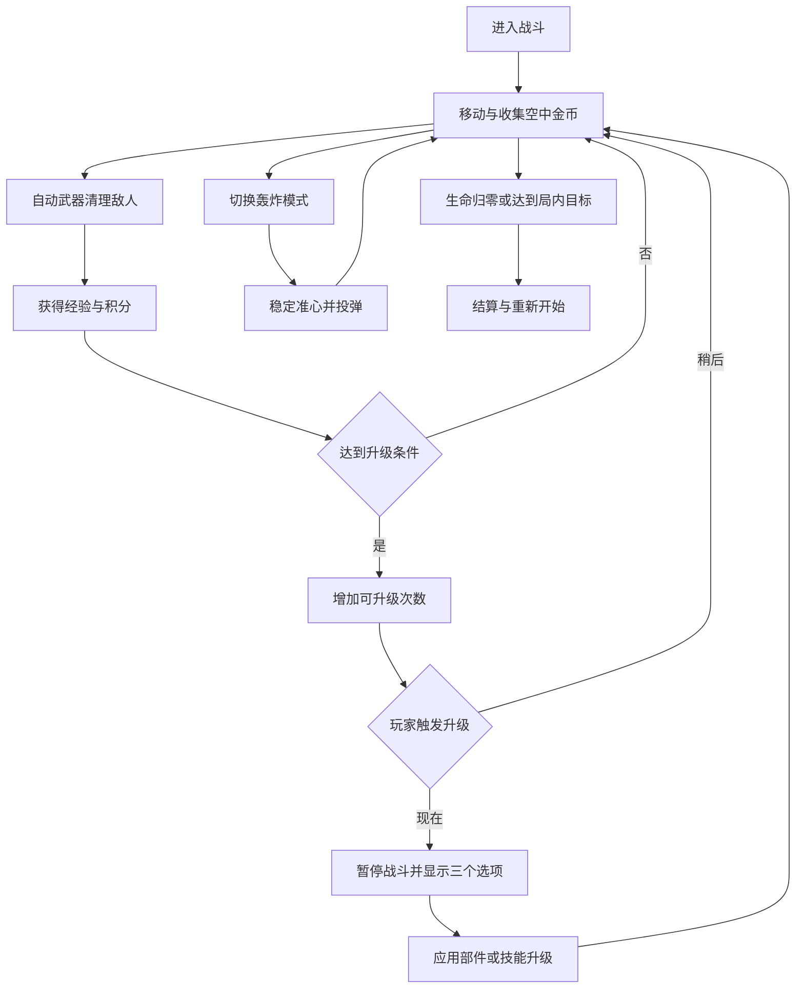
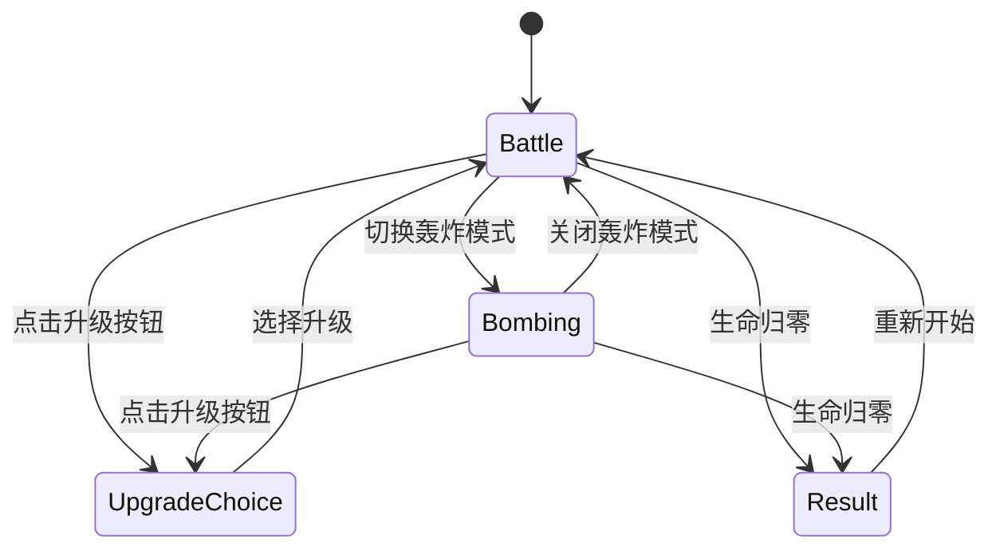

# 《Knight on Air》游戏设计文档

本文为初版设计。0.4 在同一竖屏操作与 XZ 战斗平面上调整续航、损毁、战场和时代进度。涉及这些变更时以 [0.4 战斗设计与方案评审](DESIGN_0_4.md) 和 [时代内容与迁移](content/ERA_CONTENT_0_4.md) 为准。

## 文档目标

这份文档定义第一版可玩的产品范围、核心手感、数据模型、程序化表现和实现顺序。它服务于移动端竖屏网页版，第一版以单人无尽战斗为主线，保留后续扩展关卡、敌人、载具部件和武器的接口。

文档中的数值是首轮可玩性基线。实现时需要通过移动端真机测试和数据记录继续调校，所有会影响手感的参数都应放在数据文件或配置对象中。

详细拆分文档见 [docs/README.md](README.md)。系统规则与初版内容目录分开维护，便于在开始实现后独立调整手感、内容和渲染。

## 产品定位

玩家驾驶一架可以持续改装的 3D 飞机，在带有云层、地面和风场的战场上进行风格化 lowpoly 空战与对地轰炸。游戏使用透视相机和固定俯视角，玩法保持 2.5D 的平面控制逻辑。玩家用右手单手操作屏幕中央的虚拟摇杆并点击按钮，飞机会自动完成转向、射击和部分锁定流程。战斗强调移动、提前量、能量管理、部件损坏和升级取舍，同时通过材质、粒子、声音和命中反馈保留临场真实感。

### 体验关键词

- 轻快
- 低门槛
- 目标清晰
- 反馈强
- 越升级越有形
- 每局都有不同的构筑路线

### 目标用户和场景

- 使用手机右手单手进行短局游戏的用户
- 每局 5 到 12 分钟的碎片时间
- 主要操作集中在左手摇杆和右手动作按钮
- 屏幕尺寸覆盖 360 × 640 到 430 × 932 CSS 像素
- 目标设备为近五年主流移动浏览器，优先保证触控、帧率和可读性

## 核心循环



一局的基础节奏如下。

1. 玩家移动收集金币和经验，同时自动攻击附近的空中敌人。
2. 敌方空中单位制造追击和弹幕，地面单位制造区域威胁。
3. 玩家在战斗压力中决定是否立即触发升级。
4. 玩家切换轰炸模式，对地面目标进行瞄准和投弹。
5. 随着时间推进，敌人密度、弹幕复杂度和风场强度上升。
6. 玩家死亡后按击毁数、积分、收集金币和存活时间结算。

## 屏幕和相机

### 竖屏布局

屏幕按高度划分为两个逻辑区域。

| 区域 | 高度 | 作用 |
| --- | ---: | --- |
| 游戏区 | 上方约 66.7% | 载具、空中敌人、地面、云层、弹道和战斗反馈 |
| 摇杆区 | 下方约 33.3% | 半透明控制面板、升级按钮、模式切换、轰炸按钮、摇杆 |

布局使用安全区适配刘海、圆角和浏览器底部手势条。游戏区的逻辑相机保持玩家在中心附近，玩家进入边缘时通过软边界调整地图偏移。玩家载具在游戏区中央的屏幕坐标附近保持稳定，世界物体向相反方向移动。

### 视觉层级

从远到近按以下顺序绘制。

1. 天空渐变和远景噪波
2. 低频云层
3. 地面高度场或程序化地表
4. 地面目标、道路、建筑和阴影
5. 高度较低的云片
6. 玩家飞机、空中敌人和弹道
7. UI 指示器、锁定扇形、金币、伤害数字和提示

地面和空中物体共用 XZ 平面坐标。Y 轴表示高度、遮挡关系和飞机部件的空间位置。游戏使用透视相机，视角固定在飞机后上方并跟随玩家位置。玩法在 XZ 平面计算，透视相机负责空间感、尺度变化和临场感。所有主要模型采用简单几何体拼装，使用平面法线、边缘光、局部粗糙度和粒子表现 lowpoly 轮廓与命中细节。

### 推荐坐标和相机参数

- 世界单位使用米的抽象等价单位
- 玩家高度 `playerHeight = 4`
- 透视相机俯视角 `cameraPitch = 62°`
- 透视相机视场角 `cameraFov = 48°`
- 相机与玩家的距离 `cameraDistance = 24`
- 相机跟随使用位置阻尼和轻微速度偏移，避免画面僵硬
- 相机方位角固定为 `cameraYaw = 0°`
- 游戏区可见世界半径约 28 单位
- 近裁剪面 0.1，远裁剪面 120
- UI 使用独立的 2D 场景，避免随世界缩放

## 输入和操作

### 主摇杆

摇杆位于摇杆区的左右中心位置，中心点和半径根据安全区动态计算。它为右手单手操作设计，右手拇指可以在摇杆、升级按钮、轰炸模式开关和轰炸按钮之间短距离移动。摇杆周围保留足够的空白触控区，避免误触相邻按钮。

- 摇杆方向决定飞机的目标朝向
- 摇杆距离决定加速意图
- 摇杆拉到底时加速意图为 100%
- 摇杆松开后飞机保持当前速度，并进入自然减速或风场漂移
- 摇杆输入需要死区、圆形限制和触摸平滑
- 首版以单指操作为标准流程，按钮可以在松开摇杆后立即点击
- 任何按钮点击都不会要求玩家在屏幕边缘寻找控件

建议输入映射如下。

```text
stickVector = clampToUnitCircle(rawTouch - stickCenter)
aimDirection = normalize(stickVector)                // 摇杆方向
throttleIntent = smoothstep(0.12, 0.92, length(stickVector))
```

在轰炸模式下，摇杆方向仍用于调整飞机或准心，但方向响应系数和最大位移速度降低，支持小幅微调。

### 升级按钮

升级按钮放在摇杆区顶部偏左但靠近屏幕中央的位置，显示当前可升级次数。

- 有可用次数时按钮高亮并显示数字
- 没有可用次数时按钮灰置
- 点击后暂停世界模拟、保持 HUD 动效、显示三个纵向选项
- 选项面板覆盖摇杆，玩家无法操纵飞机
- 点击选项后立即应用效果并恢复战斗
- 选项面板显示升级前后关键参数变化和外观预览
- 升级不会自动消耗金币，升级次数来自经验等级

### 轰炸模式开关

开关位于摇杆区右上角，距离摇杆边缘保持一个拇指移动步长。

- 关闭时显示战斗模式图标
- 打开时显示轰炸准心和地面落点
- 切换时保留当前移动速度，但把操控灵敏度切换为轰炸曲线
- 轰炸模式下空中武器可以继续工作，是否持续锁定由武器配置决定

### 轰炸按钮

轰炸按钮位于摇杆区右下方，初始为灰色。按钮中心与屏幕中央的水平距离不能超过单次拇指移动的舒适范围。

- 准心稳定后变为绿色并激活
- 点击后生成炸弹投射物或直接生成落点攻击
- 投弹后进入冷却，按钮显示环形倒计时
- 若准心没有稳定，按钮保持不可用并给出轻微抖动反馈

## 飞机控制模型

飞机是 3D 模型，控制逻辑是二维平面运动。飞机的头部朝向由平面上的航向角决定，模型可做小幅滚转和俯仰来增强速度感，但这些动画不改变碰撞逻辑。

### 核心参数

| 参数 | 含义 | 首版范围 |
| --- | --- | ---: |
| `maxSpeed` | 平面极速 | 7 到 16 |
| `acceleration` | 单位时间加速度 | 4 到 12 |
| `turnRate` | 最大转向角速度 | 120°/秒 到 300°/秒 |
| `energyMax` | 能量上限 | 60 到 140 |
| `energyDrain` | 满油门每秒消耗 | 12 到 24 |
| `energyRecover` | 松油门每秒恢复 | 8 到 18 |
| `drag` | 自然减速系数 | 0.4 到 1.6 |
| `brakeStrength` | 反向输入时的减速 | 3 到 8 |

### 逐帧逻辑

```text
targetHeading = angle(stickVector)                      // 无输入时保持当前航向
headingError = shortestAngle(targetHeading, heading)
maxTurnThisFrame = turnRate * deltaTime
heading += clamp(headingError, -maxTurnThisFrame, maxTurnThisFrame)

if throttleIntent > 0:
    energy -= energyDrain * throttleIntent * deltaTime
    if energy > 0:
        speed += acceleration * throttleIntent * deltaTime
else:
    energy += energyRecover * deltaTime
    speed -= drag * deltaTime

speed = clamp(speed, minimumCruiseSpeed, maxSpeed)
position += forward(heading) * speed * deltaTime
```

实际实现加入以下约束。

- 能量归零后仍可维持巡航速度，但不能继续加速
- 快速转向时施加轻微速度损失，让大飞机的转向更有代价
- 反向摇杆只改变目标航向，不让飞机瞬间倒飞
- 进入场景边界后施加软推力，避免玩家卡在边缘
- 风场先改变速度向量，再由玩家输入逐步纠正航向

### 飞机反馈

- 加速时机身尾焰长度和亮度增加
- 能量不足时尾焰闪烁，摇杆区能量条变为暖色
- 转向时根据航向误差改变滚转角，最大滚转角建议 18°
- 大翼展部件增加碰撞半径和模型惯性反馈
- 低血量时增加屏幕边缘警示和机身火花

## 武器系统

武器以数据驱动方式定义，按作用方式分为定向武器、炮台武器和范围武器。任何武器都可以组合基础伤害、穿透、弹射、齐射、散射、爆炸、制导和 buff 等模块。

### 通用武器字段

```ts
type WeaponConfig = {
  id: string
  category: 'directional' | 'turret' | 'area'
  damage: number
  fireRate: number
  projectileSpeed: number
  range: number
  projectileCount: number
  spreadAngle: number
  pierceCount: number
  bounceCount: number
  explosionRadius: number
  lockOn: boolean
  lockTime: number
  turret: boolean
  turretTurnRate: number
  homing: boolean
  homingLifetime: number
  homingNeedsEscort: boolean
  buffs: BuffEffect[]
}
```

数据层额外保存显示名称、图标、挂点、弹道样式、音效和升级链。运行时武器实例保存冷却、当前目标、锁定进度、炮塔角度和制导剩余时间。

### 定向武器

定向武器从飞机挂点方向或飞机前方扇形范围内自动寻找目标并开火。目标筛选使用距离、夹角、遮挡和威胁评分。

- 有效范围是窄扇形，不是无限宽直线
- 扇形允许玩家通过移动和提前量主动把敌人放入火线
- 默认不需要锁定，满足射速冷却后自动发射
- 适合机枪、机炮、火箭和短程导弹
- 多枚齐射可以共享一次冷却，也可以按武器配置错开发射

首版默认扇形宽度建议 24°，升级可以提升到 32°，同时降低伤害或射速以保持取舍。

### 炮台武器

炮台武器拥有独立朝向和旋转速度。

- 炮台会在旋转限制内自动追踪目标
- 炮台旋转速度决定目标切换的手感
- 炮台可以配置前后左右挂点
- 翼端炮台会扩大飞机轮廓并改变左右转向表现
- 炮台是否需要目标在炮口前方由 `turretArc` 控制

### 范围武器

范围武器作用于地面落点或目标周围区域。

- 范围武器通过准心、落点预测和冷却控制释放
- 爆炸中心可在投弹时锁定，也可由制导弹药修正
- 范围伤害按距离衰减
- 对地目标受到完整伤害，空中目标可以按配置受到部分伤害

### 锁定武器

锁定武器需要玩家保持敌人在有效扇形范围内达到指定时间。

锁定 UI 必须直接反映状态。

1. 目标进入扇形时显示宽扇形轮廓和淡色锁定标记。
2. 锁定进度增加时，扇形边缘持续收窄，颜色从蓝色经过黄色变为红色。
3. 进度达到 100% 时，扇形收至最窄并出现短促脉冲。
4. 完成锁定后立即发射，锁定条清零并进入射击冷却。
5. 目标离开有效范围时进度按配置衰减，建议每秒衰减 50%，而不是立即清零。
6. 玩家同时锁定多个目标时，每个目标显示独立的小型锁定环，主目标使用完整扇形。

锁定逻辑允许玩家打提前量。扇形检测基于目标当前位置和短时预测位置，预测时间建议为 `distance / projectileSpeed` 的 0.25 到 0.5 倍，并设置最大预测时间上限。

### 弹道和命中

- 子弹使用对象池，避免移动端频繁创建和销毁对象
- 弹道拥有最大存活时间，超出射程后销毁
- 穿透在每次命中后减少一次，数值为 0 时完成当前命中后销毁
- 弹射使用碰撞法线反射，最多执行配置次数
- 制导弹药每帧朝目标方向旋转，受 `homingTurnRate` 限制
- 需要玩家伴随的制导弹药在目标未离开玩家有效半径前持续修正
- 爆炸伤害采用圆形范围检测，避免精确网格依赖

## 轰炸模式

轰炸模式是独立的输入状态，目标是让玩家在低速微调和稳定投弹之间做选择。

### 准心

- 准心位于玩家前方地面投影点
- 投影距离由当前速度、飞机高度和炸弹初速度计算
- 摇杆输入会缓慢移动准心，而不是瞬移
- 玩家停止输入或只做小幅调整时，准心稳定度逐渐提高
- 准心半径由稳定度驱动，稳定度越高半径越小
- 稳定度达到阈值后准心变绿，轰炸按钮激活
- 受到伤害、强风或大幅移动时稳定度下降

### 稳定度模型

```text
aimMotion = length(currentAimVelocity)
stabilityGain = clamp(1 - aimMotion / stabilityMotionLimit, 0, 1)
stability += stabilityGain * settleRate * deltaTime
stability -= disturbance * deltaTime
stability = clamp(stability, 0, 1)
crosshairRadius = lerp(maxRadius, minRadius, stability)
canBomb = stability >= 0.82 && bombCooldown <= 0
```

### 投弹反馈

- 投弹瞬间显示炸弹离机和落点虚线
- 落点在地面生成短暂阴影和预警圈
- 命中后使用地面裂纹、尘土、冲击波和积分数字反馈
- 对地攻击不会暂停空中战斗，玩家需要承担切换模式的机会成本

## 资源、经验和升级

### 金币与经验

空中的金币是可收集实体。金币绕自身旋转并带有发光环，收集时播放吸附、音效和短暂倍率提示。

- 金币默认生成在玩家前方和侧前方，鼓励移动
- 金币收集后增加经验和局内积分
- 连续收集会增加短暂的收集倍率，受到伤害或超时后归零
- 金币不直接购买本局升级，避免玩家在战斗中打开商店

### 经验曲线

使用递增经验需求控制节奏。

```text
requiredXp(level) = floor(80 + level * 45 + pow(level, 1.35) * 18)
```

达到阈值后等级增加一级，同时可升级次数加一。一次升级只能消耗一次可升级次数。升级按钮可以延后触发，延后期间新的等级仍会累加次数，按钮右上角显示可用次数。

### 升级选项结构

每次触发升级显示三个候选项，候选项来自当前载具的合法升级池。

```ts
type UpgradeOption = {
  id: string
  name: string
  description: string
  rarity: 'common' | 'rare' | 'epic'
  statChanges: StatChange[]
  visualParts: VisualPartChange[]
  controlChanges: ControlChange[]
  weaponChanges: WeaponChange[]
}
```

选项卡必须包含以下信息。

- 升级名称和稀有度
- 部件预览图或轮廓变化
- 主要增益
- 可能的操控代价
- 当前武器或能量的变化
- 选择按钮和触控反馈

### 外观和手感绑定

升级不只改变数值。每个部件定义挂点、缩放、碰撞半径、惯性权重、滚转偏置和局部偏转。

| 部件例子 | 外观变化 | 数值变化 | 操控影响 |
| --- | --- | --- | --- |
| 右侧发动机 | 右侧翼展增加一个发动机 | 加速、极速、能量消耗增加 | 右转略慢，左转更灵活 |
| 左侧机枪 | 左翼增加枪管和弹药盒 | 增加一条定向武器 | 左右重量轻微不平衡 |
| 巨型装甲机身 | 机身、机翼和尾部整体放大 | 生命、火力和爆炸抗性增加 | 转向率和加速度下降 |
| 轻型整流罩 | 机身缩小，尾翼变窄 | 速度和能量恢复增加 | 碰撞半径减小，生命降低 |
| 右侧炮塔 | 右翼增加旋转炮塔 | 增加炮塔武器 | 右侧转向重量增加 |

升级效果按照三层组合。

1. 基础机体决定初始尺寸、速度、能量和武器槽。
2. 部件升级改变挂点、参数和局部外观。
3. 构筑升级改变武器行为、buff 和局部特效。

最终允许出现两类明显构筑。

- 巨无霸火力路线，伤害和范围高，动力和转向弱
- 轻型动力路线，速度和机动强，单次火力较低

## 敌人和战场

### 空中敌人

首版实现以下敌人。

| 敌人 | 主要行为 | 威胁 |
| --- | --- | --- |
| 侦察机 | 远距离绕行并呼叫增援 | 增加敌人密度 |
| 追猎机 | 追向玩家并短距离射击 | 逼迫玩家转向 |
| 轰炸机 | 低速直线飞行，对地投弹 | 创造区域危险 |
| 护卫无人机 | 围绕精英单位旋转 | 保护高价值目标 |
| 精英空艇 | 低速高血量，发射多种弹幕 | 阶段性压力 |

### 地面敌人

地面单位固定在地表或沿道路移动。

- 防空炮，向玩家发射可预警的直线炮弹
- 导弹车，发射需要玩家改变方向的追踪弹
- 机枪阵地，创建扇形弹幕
- 资源车，作为高分和高经验目标
- 建筑目标，受到范围攻击后分阶段损毁

地面武器用预警圈、激光指示或弹道虚线提供足够反应时间。地面攻击和云层遮挡不能让伤害来源不可读。

### 云朵和天气

- 云朵由程序化噪波生成的透明体积片或多层半透明 billboard 组成
- 云层改变颜色、雾度和远处地面可见度
- 云层不直接遮挡关键 UI 和敌人锁定标记
- 风场以低频噪波采样，形成方向和强度随时间变化的向量场
- 强风区域通过粒子、云丝和飞机尾迹提示
- 风对飞机速度向量和轰炸准心稳定度产生影响
- 风场强度随战斗阶段增加，但需要给出视觉预警

## 程序化资源和着色器

所有资源使用 procedure 方式生成，项目不依赖外部贴图。3D 模型可使用低多边形几何体、参数化网格和运行时部件拼装，表面细节由 shader 和噪波完成。

### 程序化模型

- 飞机机身由截面曲线沿长度采样生成
- 机翼由根部、翼尖、后掠角和厚度参数生成
- 发动机由圆柱、喷口环和尾焰挂点生成
- 炮塔由底座、旋转环和枪管生成
- 云朵由多个球状体或 billboard 体积片组合
- 地面由分块网格和高度噪波生成

模型配置只存参数，不存导出的纹理贴图。

### Shader 规划

| Shader | 用途 | 核心输入 |
| --- | --- | --- |
| `terrain` | 地面颜色、道路、坡度混合 | 世界坐标、法线、噪波、风向 |
| `cloud` | 云层透明度和流动 | 时间、噪波、光照方向、密度 |
| `aircraft` | 机身材质和损伤闪烁 | 金属度、边缘光、损伤值、部件色 |
| `propulsion` | 发动机尾焰和能量颜色 | 速度、油门、能量、时间 |
| `projectile` | 子弹、导弹、激光和爆炸体 | 生命周期、颜色、速度、目标方向 |
| `crosshair` | 轰炸准心和锁定扇形 | 稳定度、锁定进度、激活状态 |

### 噪波使用

- 分形布朗运动用于地面颜色和云层密度
- 低频噪波用于风场方向变化
- 高频噪波用于尾焰、爆炸、尘土和损伤闪烁
- 噪波采样必须尽量在 shader 中完成，减少 CPU 生成纹理的内存占用

## UI 规格

### 游戏区 HUD

- 左上显示生命值和能量值
- 顶部中央显示当前等级、经验进度和连击倍率
- 右上显示积分、金币和局内时间
- 玩家前方显示锁定扇形、目标血条和距离
- 地面目标显示预警圈和目标类型图标

### 摇杆区

摇杆区使用黑色或深蓝色半透明面板，建议不透明度 0.45 到 0.62。面板不能完全遮住游戏区，顶部留出升级按钮和模式开关的触控间距。

- 左右居中位置为摇杆底盘和摇杆帽
- 右下为轰炸按钮
- 顶部偏左为升级按钮和次数角标
- 顶部偏右为轰炸模式开关
- 能量条可以贴近摇杆上沿，避免遮挡摇杆操作
- 所有按钮的可触区域至少 44 CSS 像素

### 升级面板

升级面板覆盖摇杆区并向游戏区上沿延伸，但不遮挡关键战斗反馈。

- 三个选项纵向排列
- 每项高度建议 72 到 96 CSS 像素
- 面板出现时世界时间缩放到 0，UI 动画仍继续
- 选项卡显示缩略外观、名称、三项主要变化和选择按钮
- 选项确认后播放部件拼装动画，持续 0.35 到 0.6 秒

### 局外 UI

局外界面使用独立的 3D 展示场景。当前装备的飞机持续朝屏幕上方飞行，透视相机保持在飞机后上方，云层、地面和尾焰提供待机中的空间运动。底部切换栏包含商店、装备、出击和两个预留入口，出击页默认选中。

- 主界面靠下显示当前飞机摘要和出击按钮
- 点击出击直接进入第一关副本
- 装备界面可以浏览、预览和装备已解锁飞机
- 商店和两个预留入口使用可返回的占位页
- 局外飞机展示使用当前装备的程序化几何体和部件构型

详细规则见 [局外 UI 和主界面系统](systems/07-meta-ui.md) 和 [初版局外 UI 内容](content/OUT_OF_BATTLE_UI.md)。

## 游戏状态和代码架构

当前代码将固定步模拟、场景渲染、输入、内容库和页面流程放在独立模块。文件入口见 [统一战斗架构](ARCHITECTURE_0_4.md#当前运行时架构)。

```text
src/
  app/GameApp.ts
  input/VirtualStick.ts
  simulation/World.ts
  simulation/FlightDynamics.ts
  simulation/Controllers.ts
  simulation/HitTest.ts
  simulation/DamageModel.ts
  content/3d/AircraftFactory.ts
  content/3d/anchors.ts
  content/fx/CombatEffects.ts
  content/2d/CombatHud.ts
  data/combatants.ts
  rendering/Renderer.ts
```

### 模拟状态机



升级选择时暂停世界模拟。暂停标志由 `WorldClock` 统一管理，所有战斗系统读取同一时间缩放，避免有的系统继续移动而有的系统停住。

### 更新顺序

每帧按以下顺序更新。

1. 读取输入并更新输入状态
2. 更新风场采样和世界边界
3. 更新玩家飞机速度、航向和能量
4. 更新敌人行为和地面武器预警
5. 更新武器目标、锁定、炮台和冷却
6. 更新弹道、碰撞和伤害
7. 更新金币、经验、升级次数和连击
8. 更新轰炸准心与投弹状态
9. 更新相机跟随和视觉反馈
10. 更新 HUD 和特效参数

碰撞和进度更新使用固定时间步或半固定时间步，渲染使用插值，保证低帧率设备不会让锁定、射速或能量消耗出现明显漂移。

## 首版数值基线

以下数值用于第一个可玩原型。

| 项目 | 初始值 |
| --- | ---: |
| 玩家生命 | 100 |
| 玩家极速 | 10 |
| 玩家加速度 | 7 |
| 玩家转向率 | 220°/秒 |
| 能量上限 | 100 |
| 满油门耗能 | 16/秒 |
| 松油门恢复 | 12/秒 |
| 基础机枪伤害 | 8 |
| 基础机枪射速 | 5 发/秒 |
| 基础机枪射程 | 20 |
| 锁定导弹锁定时间 | 1.2 秒 |
| 轰炸冷却 | 4 秒 |
| 轰炸稳定阈值 | 0.82 |
| 初始升级经验 | 120 |
| 第一波敌人出现 | 0 秒 |
| 精英敌人首次出现 | 90 秒 |

## 性能和兼容性目标

- 主流中端移动设备目标 60 FPS，低端设备目标不低于 30 FPS
- 首屏交互在 3 秒内完成
- 单帧活动实体建议控制在 250 个以内，弹道和金币使用对象池
- 透明云层和粒子要有质量档位
- 默认启用 WebGL，WebGL 不可用时提供最低限度的降级提示
- 通过 `devicePixelRatio` 上限和动态分辨率控制 GPU 压力
- 触摸事件使用 passive 监听策略，并阻止页面在游戏区滚动
- 预加载阶段只加载程序和 shader 参数，避免等待大体积贴图

### 质量档位

| 档位 | 云层 | 粒子 | 阴影 | 分辨率比例 |
| --- | --- | --- | --- | ---: |
| 省电 | 单层 billboard | 低 | 无实时阴影 | 0.70 |
| 标准 | 多层 billboard | 中 | 简化阴影 | 0.85 |
| 高 | 噪波体积感 | 高 | 软阴影 | 1.00 |

## 数据保存和局外扩展

第一版允许保存以下内容。

- 最高分
- 最长存活时间
- 解锁的飞机机体
- 当前装备的飞机
- 解锁的升级池条目
- 第一关开放状态、玩家等级和局外金币
- 音效、画质和触控设置

局内升级和金币默认只在当前局有效。后续如需局外成长，可加入机库和永久解锁，但要保持局内构筑仍有独立决策价值。

## 埋点和调校

至少记录以下事件。

- 局开始、局结束和结束原因
- 玩家每次升级选项和选择结果
- 玩家切换轰炸模式的次数和持续时间
- 轰炸尝试、成功、取消和命中结果
- 锁定武器开始锁定、失锁和成功发射
- 玩家受到伤害的来源
- 每局平均速度、能量耗尽次数、收集金币数和升级时间

埋点用于调整节奏、判断选项强弱和定位移动端操作问题。正式环境可以关闭详细日志，只保留匿名聚合数据。

## 开发里程碑

### M0 设计验证

- 建立 TypeScript、Three.js、Vite 和基础 WebGL 页面
- 建立局外主界面、底部切换栏和装备页的基础路由
- 显示当前飞机持续朝屏幕上方飞行的 3D 展示场景
- 点击出击进入第一关的占位战斗场景
- 在竖屏画布中显示游戏区和摇杆区
- 完成摇杆输入、固定相机和玩家平面移动
- 用几何体验证转向、加速和能量手感

验收标准是手指拖动方向稳定，飞机可以快速对准目标朝向，松开摇杆后行为可预期。

### M1 战斗闭环

- 加入基础机枪、子弹对象池和空中敌人
- 加入金币、经验、等级和升级面板
- 加入三选一升级并完成基础外观变化
- 加入生命、死亡和结算

验收标准是一局可以完整进行 5 分钟，升级按钮和选项在真实触摸设备上可用。

### M2 锁定和轰炸

- 加入锁定扇形、进度颜色和失锁衰减
- 加入地面目标、防空火力和地面命中反馈
- 加入轰炸模式、准心稳定度和投弹冷却
- 加入云层和风场

验收标准是玩家能够清楚理解锁定、准心稳定和投弹成功与否。

### M3 程序化表现

- 用参数化网格替换占位飞机
- 加入飞机部件拼装和升级后变形
- 加入 terrain、cloud、aircraft、projectile 和 crosshair shader
- 加入质量档位和动态分辨率

验收标准是主要战斗资源不依赖贴图文件，外观变化能直接表达升级方向。

### M4 内容和调优

- 扩充敌人和升级池
- 设计精英敌人和阶段性风场
- 完成移动端性能测试、触控测试和可访问性测试
- 调整经验曲线、武器强度、升级稀有度和敌人密度

## 验收清单

### 操作

- 摇杆死区、边界和多指触控可用
- 摇杆方向能稳定映射到飞机目标朝向
- 加速受能量限制，能量恢复反馈清晰
- 升级时摇杆被覆盖并确实无法操纵
- 轰炸模式的准心可微调，稳定后按钮变绿

### 战斗

- 定向武器使用窄扇形自动攻击
- 炮台有独立旋转速度和转向限制
- 锁定武器有清晰的收窄、变色和发射反馈
- 范围武器命中地面后有明确落点和爆炸范围
- 穿透、弹射、齐射、散射、爆炸和制导按配置生效

### 成长

- 金币能被收集并增加经验
- 到达经验阈值会增加可升级次数
- 升级按钮角标准确显示次数
- 升级选项会改变参数、外观或控制手感
- 大型和轻型构筑在视觉和操作上都能区分

### 表现和性能

- 云、地面、飞机和弹道使用程序化表现
- 透视相机的固定视角跟随玩家载具
- 目标设备上达到对应质量档位的帧率目标
- 页面不会因触摸游戏区而滚动或缩放

## 当前实现决策

本版本默认使用 Three.js、TypeScript 和 Vite。Three.js 负责透视相机、参数化 3D 几何体、程序化材质、后处理和 WebGL shader，DOM 或 Canvas UI 负责摇杆区、升级选项和可读性要求较高的 HUD。模拟层不依赖 Three.js 的对象，因此后续可以在保持模拟层接口不变的前提下替换渲染层。

首个可玩版本优先保证移动端输入、战斗循环、升级反馈和性能。程序化资源先做低多边形和 shader 细节，再逐步增加云层、风场和部件材质的层次。
