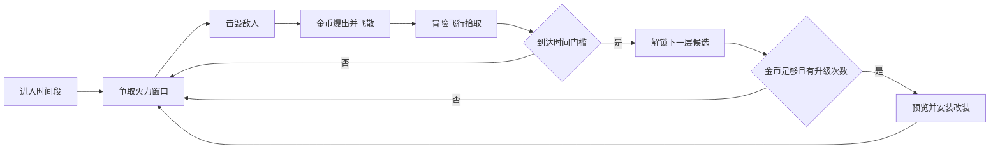

# 局内经济与成长机制调查报告

**项目**：Knight on Air · 云端骑士  
**调查日期**：2026-11-27  
**调查范围**：以《土豆兄弟》为主，比较《吸血鬼幸存者》《20 Minutes Till Dawn》《Halls of Torment》《Soulstone Survivors》《Deep Rock Galactic: Survivor》和《Nova Drift》，并结合当前仓库的局内成长实现给出可落地建议。

## 一、结论摘要

当前设想可以成立，但需要先把四个概念分开。金币是玩家主动花费的局内预算，XP 是推动成长机会的进度，升级次数是已经兑现的选择权，时间是关卡节奏与内容解锁的时钟。四者承担不同职责时，玩家才能读懂“我为什么现在能升级”“我为什么买不起”“我是否应该继续冒险收集”。

《土豆兄弟》最值得借鉴的是每一波结束后的完整决策窗口，以及把同一批敌人掉落物同时转化为经验和商店货币。它把战斗、拾取、升级、商店、锁定、刷新和下一波威胁连成短循环，玩家每波都要做一次明确取舍。对 Knight on Air 来说，可以保留这种短循环，但把商店改造成“飞行中的改装窗口”，让购买结果直接改变飞机轮廓、挂点和操控。

《吸血鬼幸存者》证明了低操作负担下的持续拾取和自动攻击可以支撑强烈的成长反馈。它把 XP 宝石与局外金币分开，运行中只负责变强，结算后再把金币投入长期成长。这适合用来约束 Knight on Air 的局外货币，避免本局金币同时承担永久成长职责。

《20 Minutes Till Dawn》证明固定时长可以成为清晰的进度承诺。它在 20 分钟内持续提供升级选择，再用局外 Souls 和符文承接长期成长。Knight on Air 可以借鉴“时间段带来内容变化”的节奏，但不能让时间自动替代战斗表现，否则玩家会产生挂机等待升级的最优解。

《Deep Rock Galactic: Survivor》与《Nova Drift》对本项目的参考价值更直接。前者把击杀、采矿、任务目标和阶段性强化放在同一条风险收益线上，后者则把每次击败敌人后的快速构筑和飞船形态变化作为核心卖点。两者都说明，飞行游戏中的成长应当改变空间问题，而不只是提高一个抽象数值。

建议采用以下目标循环。

建议将“击中敌人”用于战斗反馈，将“击毁敌人”用于经济奖励。每一发命中都掉金币会让多段伤害、持续燃烧和爆炸武器产生重复收益，击毁确认点更容易保持预算稳定。若需要奖励高质量射击，可以把额外金币绑定首击、弱点命中、连续击杀或主目标击杀，而不是绑定所有伤害事件。

## 二、当前项目基线

当前仓库已经存在一套可运行的局内经济骨架。

| 当前行为 | 代码位置 | 对设计的影响 |
|---|---|---|
| 敌机被击毁后按奖励配置生成最多 6 个金币拾取物 | `src/simulation/World.ts` 的 `finishEnemy` | 已具备“敌人爆金币”的视觉与空间风险 |
| 金币拾取同时增加金币、XP、分数和连击 | `src/simulation/World.ts` 的 `updatePickups` | 一个拾取物同时承担战斗成长和消费预算 |
| XP 跨过阈值后累计升级次数并保留溢出 XP | `src/simulation/World.ts` 的 `awardXp` | 可以支持一次拾取连续升多级 |
| 安装升级时校验金币和升级次数，成功后扣除金币 | `src/simulation/World.ts` 的 `chooseUpgrade` 与 `upgradePrice` | 已经有明确的“货币购买改装”动作 |
| 升级候选按当前构型、前置和冲突关系筛选 | `openspec/specs/battle/aircraft-refit/spec.md` | 可以承载分时间段开放的候选池 |
| 精英敌人目前按经过时间生成 | `src/simulation/World.ts` 的 `eliteAt` | 已有时间导演入口，可扩展为阶段解锁 |

当前实现与目标设想之间有三个需要明确的差异。

第一，当前金币不是单纯的购买预算。金币拾取会调用 `awardXp`，所以玩家必须同时考虑拾取路线、经验阈值和安装价格。这个耦合能带来取舍，但会让玩家难以判断“金币不够”究竟是没击毁、没拾取，还是升级价格过高。

第二，当前升级机会由 XP 触发，并且可以累积。仓库中的局内成长规格明确要求保留 XP 溢出和可用升级次数，尚未定义“按固定时间自动解锁下一层升级池”的行为。

第三，当前升级价格按稀有度提供默认值，候选的购买动作与候选是否解锁是两个不同问题。若加入时间门槛，应将候选解锁状态加入合法候选判断，不能只在 UI 中显示锁定。

相关基线见 [玩法与构筑设计](GAMEPLAY_DESIGN.md)、[局内成长规格](../openspec/specs/battle/in-run-progression/spec.md) 和 [机体改装规格](../openspec/specs/battle/aircraft-refit/spec.md)。

## 三、《土豆兄弟》的局内成长与经济

### 3.1 基本循环

《土豆兄弟》一局由 20 个 Wave 组成。第 1 波持续 20 秒，之后每波增加 5 秒，达到 60 秒后保持，最终 Boss 波为 90 秒。每波结束后，剩余材料会被收集到袋中，玩家处理掉落箱、升级选择和商店，然后进入下一波。

它把战斗时长切成固定的小段，同时保留波内自由移动。玩家可以在波内承担拾取风险，也可以先保证生存，再利用波末窗口整理构筑。对于 Knight on Air，这种结构适合映射成“时间段结束后出现一次安全改装机会”，同时保留战斗中的金币追逐。

### 3.2 材料、经验和金币的双重身份

敌人死亡时掉落绿色材料。材料既计入 XP，也计入商店货币。Harvesting 在波末提供材料，未拾取的材料不会丢失，而是进入 Bag，在后续掉落时回收。场上材料有数量上限，超过上限的价值会并入已有材料，不会因为实体数量受限而直接损失价值。

这套设计同时解决了三个问题。敌人掉落物具有即时追逐价值，玩家不会只依赖波末结算。玩家没有捡完时不会感到被系统惩罚，降低了清屏压力。场上实体上限也不会让经济系统失控。

需要注意的是，《土豆兄弟》在界面中把材料称为同一种资源，但其内部和部分角色效果仍区分 XP 与 Gold。这个做法适合制造简单的第一认知，但不适合 Knight on Air 直接照搬，因为飞行过程中玩家还要判断是否脱离火力窗口去拾取。

### 3.3 商店决策

每波结束后商店最多提供 4 个随机物品或武器。玩家可以购买、锁定、刷新和回收。锁定物品会保留到下一波，并保持当时价格，形成“现在买不起但值得留住”的预算决策。刷新价格随波数和当前商店内刷新次数上升，物品价格随波数通胀。

商店候选受角色、Luck、已有武器和物品稀有度影响。前 5 个商店有额外限制，后续波次才逐步开放更高稀有度。这样可以控制开局构筑的学习成本，也能把强力内容延迟到玩家已经理解基础构筑之后。

对于 Knight on Air，可以借鉴三项机制。

| 《土豆兄弟》机制 | 适合的空战改造 |
|---|---|
| 波末商店 | 固定时间段结束后打开“改装托盘”，保留战场背景但冻结模拟 |
| 锁定 | 锁定一个候选改装，保留到下个时间段，代价是放弃一次刷新或占用候选位 |
| 价格通胀 | 后期强力改装价格上涨，迫使玩家在当前收益与未来保留之间决策 |

不建议直接照搬四格商店。空战改装改变的是飞机结构和操控，候选数量过多会压缩比较时间。三张候选卡加一张“保留/刷新”操作已经足够形成选择压力。

### 3.4 XP 曲线与升级机会

《土豆兄弟》的升级阈值按平方增长。XP 进入阈值后，玩家每次升级获得一项升级机会，剩余 XP 保留。一次奖励可以连续跨越多个等级，因此高价值拾取会产生连续选择。

它的关键不在于具体公式，而在于 XP 不会因为错过一次选择而消失。玩家可以先继续战斗，等安全时再处理升级。当前 Knight on Air 已经实现“升级次数累积”，这一点应该保留。

### 3.5 对本项目的可借鉴点

- 让金币以实体形式落在击毁位置，迫使玩家在火力窗口、规避和拾取之间做空间决策。

- 对未拾取金币采用回收或延迟转移，避免飞机被迫飞回危险区域才能完成成长。

- 把强力候选按时间段分层开放，用阶段解锁控制构筑复杂度。

- 让锁定候选保留到下一段，奖励玩家对未来路线的判断。

- 让价格、刷新和锁定都围绕同一个金币预算，避免出现多个互不相干的局内货币。

来源为 [Brotato Steam 商店页](https://store.steampowered.com/app/1942280/Brotato/)、[Materials](https://brotato.wiki.spellsandguns.com/Materials)、[Shop](https://brotato.wiki.spellsandguns.com/Shop)、[Waves](https://brotato.wiki.spellsandguns.com/Waves) 和 [Experience](https://brotato.wiki.spellsandguns.com/Experience)。

## 四、同类型游戏比较

### 4.1 《吸血鬼幸存者》

《吸血鬼幸存者》把敌人掉落的 XP 宝石作为局内主要成长资源。玩家吸收宝石后升级并从候选中选择武器或被动，武器自动攻击，玩家主要负责走位、聚拢敌群、寻找宝箱和决定拾取路径。局内获得的 Gold 在结算后用于局外 PowerUp，形成局内构筑和局外成长的清晰分层。

对 Knight on Air 的启发是把“移动到掉落物附近”变成真正的空间决策。金币可以采用吸附半径和磁力升级，远处金币不必立即消失，玩家可以在危险解除后回收。局外金币应继续用于长期解锁，局内金币只用于本局改装，防止一个数值同时承担两条成长曲线。

来源为 [Vampire Survivors Steam 商店页](https://store.steampowered.com/app/1794680/Vampire_Survivors/)。

### 4.2 《20 Minutes Till Dawn》

《20 Minutes Till Dawn》以 20 分钟生存为明确目标。击杀敌人获得经验，玩家从武器、召唤和特殊能力中选择升级。局外 Souls 用于 Runes，角色和武器也通过长期进度解锁。

它的核心价值是时间承诺清晰。玩家知道一局何时结束，也知道某个阶段应该准备更强的构筑。它同时保留了局内随机选择和局外长期成长，短时间内可以反复实验。

对 Knight on Air 的借鉴是将一局拆成 30 秒或 45 秒的航段，每个航段拥有明确的威胁变化和候选开放规则。时间门槛只负责解锁候选池或出现新的敌人职责，金币仍然必须通过击毁和拾取获得。这样玩家不会只绕圈等下一层开放。

来源为 [20 Minutes Till Dawn Steam 商店页](https://store.steampowered.com/app/1966900/20_Minutes_Till_Dawn/)。

### 4.3 《Halls of Torment》

《Halls of Torment》提供约 30 分钟的快速局，并把角色、能力、物品、任务、Blessings、Artifacts 和长期解锁组合在一起。局内强化服务于当前角色构筑，任务和角色标记则推动跨局目标。

它的借鉴点是“局内行为可以同时服务即时战斗和长期目标”。Knight on Air 可以把主目标击毁、保护目标存活、完成投弹和收集金币分别记入任务，但不应把任务奖励直接变成局内必选强化，否则玩家会为了任务脱离当前战术。

来源为 [Halls of Torment Steam 商店页](https://store.steampowered.com/app/2218750/Halls_of_Torment/)。

### 4.4 《Soulstone Survivors》

《Soulstone Survivors》以收集 Soulstones、解锁角色、升级技能树、打造武器和应对诅咒为主。它把大量技能和成长节点组合成高密度构筑，强调协同效果和长期实验。

它对本项目的借鉴有限，主要适合参考“标签和协同关系”而不是数量规模。Knight on Air 可以给升级打上火力、机动、装甲、能源、轰炸和结构标签，再让候选池根据已有标签提高协同概率。强力组合应改变飞机的空间行为，例如增加武器覆盖会扩大受弹面，增加发动机会提高推力但增加滚转惯量。

来源为 [Soulstone Survivors Steam 商店页](https://store.steampowered.com/app/2066020/Soulstone_Survivors/)。

### 4.5 《Deep Rock Galactic: Survivor》

《Deep Rock Galactic: Survivor》把击杀、采矿、任务目标、阶段强化和撤离放入同一局。玩家需要在自动射击的同时挖掘资源，完成任务并回到 Drop Pod。地图和敌群都具有阶段性，资源价值与路线风险直接相关。

它与 Knight on Air 最接近的地方是“战斗资源必须通过移动路线获得”。空战金币不应只是敌人死亡时自动加入账户，而应短暂留在击毁地点，形成追击、绕行和撤离的选择。主目标奖励可以高于普通敌机，但应通过明确的任务反馈让玩家知道这是一种战略收入。

来源为 [Deep Rock Galactic: Survivor Steam 商店页](https://store.steampowered.com/app/2321470/Deep_Rock_Galactic_Survivor/)。

### 4.6 《Nova Drift》

《Nova Drift》是强调构筑的太空射击游戏。它把武器、护盾和机体作为主要构筑槽位，飞船会随着击败敌人快速进化，短局内可以从起始方案发展成完整流派。

它对 Knight on Air 的直接启发是每次升级都应让玩家看到“飞行方式改变了”。增加机枪不只是 DPS 上升，而是改变有效射界和火力窗口。增加翼面不只是生命上升，而是改变受弹面积和转向响应。升级预览需要展示结构变化、挂点变化、质量变化和操控代价。

来源为 [Nova Drift Steam 商店页](https://store.steampowered.com/app/858210/Nova_Drift/)。

## 五、对当前设想的机制拆解

### 5.1 金币掉落时机

建议以“击毁确认”作为基础掉落点，以“命中质量”作为少量加成来源。

| 事件 | 建议收益 | 原因 |
|---|---:|---|
| 普通敌机击毁 | 1–3 个金币碎片 | 保证基础循环稳定 |
| 精英击毁 | 4–8 个金币碎片或一枚大金币 | 形成明显的风险回报 |
| 主目标完成 | 固定奖金加阶段奖励 | 让副本目标和刷杂兵有清晰区别 |
| 首次弱点命中 | 少量连击加成 | 奖励读懂敌机，而不是奖励每一发子弹 |
| 多段持续伤害 | 不重复生成基础金币 | 避免燃烧、爆炸和多炮位倍率失控 |

金币碎片应在敌人当前位置短暂散开，再以可控的吸附速度向飞机移动。建议金币的寿命长于一个普通交锋窗口，并允许进入“待回收”状态。玩家因规避暂时错过时，金币可以在下一段沿路线缓慢靠近，或在航段结束时按比例回收。

### 5.2 金币与 XP 的关系

有三种可选方案。

| 方案 | 优点 | 风险 | 适合度 |
|---|---|---|---|
| 一个金币同时给钱和 XP | 认知简单，拾取价值高 | 玩家无法拆分“买改装”和“升等级” | 可作为当前过渡方案 |
| 金币和 XP 完全分离 | 预算可控，容易平衡 | 场上掉落物变多，拾取压力上升 | 适合长期版本 |
| 金币主资源，时间授予升级次数 | 规则简单，符合固定时间解锁 | 时间可能替代战斗表现 | 适合强调阶段节奏的版本 |

推荐采用折中方案。普通金币只增加金币，击毁和任务直接提供少量 XP 或升级进度。时间段结束时保证一次候选解锁或升级机会，额外 XP 来自高质量战斗。这样玩家即使金币不足也不会完全失去成长，但想要快速安装高价结构仍必须主动击毁并拾取。

### 5.3 固定时间解锁下一步升级

时间门槛建议作用于“候选池层级”，而不是直接免费安装。

| 时间段 | 内容重点 | 候选层级 |
|---|---|---|
| 0–45 秒 | 认识基础飞机和金币路线 | 通用提质，低风险武器 |
| 45–90 秒 | 形成第一条构筑方向 | 机翼、发动机、基础挂点 |
| 90–150 秒 | 面对精英和路线压力 | 炮塔、炸弹舱、装甲、能源 |
| 150–210 秒 | 形成明显的构型代价 | 双侧扩建、特殊武器、非对称结构 |
| 210 秒以后 | 收束与 Boss 准备 | 高价终局改装和一次性强化 |

每个时间段至少应提供一项当前构型合法的候选，避免玩家因为随机池和金币不足同时被锁死。进入下一段时可以自动刷新一次候选，玩家此前锁定的候选保留，但价格不冻结或只冻结一个时间段，防止无限囤积。

### 5.4 升级价格与预算

升级价格应由稀有度、结构规模和改变操控的程度共同决定。可以从以下比例开始测试。

| 升级类别 | 建议价格区间 | 示例 |
|---|---:|---|
| 通用提质 | 6–10 | 射速、加速、锁定时间 |
| 单侧小部件 | 8–14 | 单侧机枪、短翼段、小散热器 |
| 双侧结构扩展 | 14–24 | 左右翼延长、双发动机 |
| 高风险高收益 | 20–32 | 炮塔、炸弹舱、特殊武器 |
| 终局构型 | 30–50 | 多段扩建、非对称炮艇化 |

价格不应只按卡片稀有度配置。结构卡同时改变受弹区域、质量、转向和挂点容量，价格需要覆盖这些隐性价值。候选卡应显示当前金币、价格、购买后余额和下一次可用时间段。

### 5.5 拾取与空间风险

空战与地面幸存者游戏的差异在于玩家速度更高、路线更长、敌人有明确的射界。金币拾取必须让玩家调整航向，但不能要求玩家停在敌人火线中。

建议加入四个参数。

- **爆出半径**决定金币从敌人中心散开的视觉范围。

- **吸附半径**决定玩家靠近时是否自动收集。

- **吸附加速度**决定高速飞行时玩家是否需要减速。

- **回收时间**决定错过拾取后是否仍有机会在航段末获得部分价值。

建议普通金币采用中等寿命和强吸附，精英大金币采用更长寿命但更远爆出距离。这样普通敌人服务于持续循环，精英击杀形成一次明确的路线决策。

## 六、推荐的 Knight on Air 方案

### 6.1 资源定义

| 资源 | 来源 | 用途 | 是否跨局保留 |
|---|---|---|---|
| 局内金币 | 敌人击毁、主目标、金币拾取 | 购买和刷新局内改装 | 结算后按规则转为奖励或清零 |
| 战斗 XP | 高质量击毁、主目标、阶段奖励 | 推动升级次数或候选解锁 | 清零 |
| 升级次数 | XP 阈值、时间段保底 | 消费一次安装一个候选 | 清零 |
| 局外货币 | 结算、成就、任务 | 解锁机体、外部升级 | 保留 |

局内金币与局外货币必须使用不同名称、图标和颜色。当前代码中 `coins` 既用于本局余额又在结算进入存档，报告建议在产品层明确显示“本局金币”和“结算奖励”，避免玩家误以为击毁后马上增加永久资产。

### 6.2 一局节奏

建议把 5–12 分钟的一局拆成 6 个阶段，每阶段约 45–75 秒。阶段开始时展示即将出现的敌人职责和可解锁改装标签。阶段中玩家争取击毁和拾取，阶段末冻结模拟 3–5 秒或打开底部改装托盘。阶段结束不强制玩家立即安装，保留升级次数和锁定候选。

阶段结构可以如下。

| 阶段 | 战斗目的 | 经济目的 | 解锁目的 |
|---|---|---|---|
| 1 | 熟悉航向和火力窗口 | 获取第一笔金币 | 通用提质 |
| 2 | 处理第一组追猎机 | 购买低价改装 | 小型结构件 |
| 3 | 应对精英或俯冲攻击 | 选择保留还是刷新 | 双侧结构和能源 |
| 4 | 完成主目标或轰炸 | 为高价改装攒钱 | 炮塔、炸弹舱 |
| 5 | 处理密集威胁 | 用金币交换稳定性 | 高风险高收益 |
| 6 | Boss 或返航 | 消耗剩余预算 | 终局强化 |

### 6.3 候选池规则

候选生成应同时检查时代、机体、当前挂点、前置、互斥、阶段层级和价格。候选层级未解锁时不能进入抽选池，而不是抽到后仅显示灰色。候选不足时从当前阶段允许的可重复提质卡补足，保证三选一契约仍成立。

建议每次提供三张卡。

- 一张与当前构筑标签相协同的候选

- 一张改变空间或操控方式的候选

- 一张安全的通用兜底候选

这比完全随机更容易让玩家理解构筑方向，也能减少“金币足够但三张都不能装”的无效等待。

### 6.4 反馈与可读性

击毁时使用爆金币动画、短促音效和明确数值。金币拾取时使用连续但有上限的连击音高，避免每个碎片都播放完整音效。升级候选必须同时显示收益、代价、价格、购买后余额、结构预览和解锁条件。

HUD 至少应显示本局金币、金币飞向飞机的数量、下一阶段倒计时、当前升级次数和候选池层级。若金币未拾取而进入回收状态，应显示“待回收”而非直接消失。

## 七、平衡风险与验证方法

### 7.1 需要避免的失衡

- 每次命中都掉金币会让高射速、多炮位、持续伤害武器成为唯一最优解。

- 金币同时给 XP 又承担购买，会让磁力、拾取半径和金币倍率同时放大两条成长曲线。

- 固定时间免费给强力升级会产生绕圈等待的最优策略。

- 过多低价升级会让结构扩建失去价值，玩家只堆通用射速和伤害。

- 金币寿命过短会惩罚轰炸、返航和高速度机体，玩家会为了拾取破坏任务目标。

- 只按稀有度定价会低估结构升级带来的碰撞、质量和挂点价值。

### 7.2 首轮数值试验

建议固定 6 个阶段和 3 个起始机体，比较三种配置。

| 试验组 | 金币来源 | XP 来源 | 阶段解锁 |
|---|---|---|---|
| A | 击毁后碎片，拾取才入账 | 金币同时给 XP | 每 60 秒开放候选层级 |
| B | 击毁后碎片，拾取才入账 | 击毁直接给少量 XP | 每 60 秒开放候选层级 |
| C | 击毁后自动入账，少量碎片作额外奖励 | 击毁直接给 XP | 每 60 秒开放候选层级 |

每组记录以下指标。

- 第一次购买发生时间和第一次结构变化时间

- 每个阶段结束时的金币余额、已安装卡数和未拾取金币价值

- 金币拾取期间承受的伤害与死亡率

- 普通敌机、精英、主目标对金币总收入的贡献

- 三张候选中无法安装的比例

- 玩家是否在阶段门槛前主动寻找敌人，还是只绕圈等待

- 改装后飞机的速度、转向、受弹面积、火力覆盖和任务完成率

目标不是让三组收益相同，而是确认玩家能从操作和反馈中理解收入来源、购买条件和阶段门槛。若 A 组的拾取伤害明显高于 B 组，应增加金币寿命或提高安全回收比例，而不是单纯提高金币掉落量。

### 7.3 建议的验收场景

1. 普通敌机被机炮击毁后，金币在击毁位置分散，玩家驶近后逐枚或成簇吸附，HUD 余额与实际拾取数量一致。

2. 同一敌机受到多段燃烧、爆炸和多炮位伤害时，只生成一次基础金币奖励，额外奖励由击毁类型或主目标规则计算。

3. 玩家在金币不足时打开改装托盘，候选仍能预览，确认按钮显示差额，不能扣除金币或升级次数。

4. 玩家在阶段门槛前获得大量金币，仍不能安装下一层候选，进入门槛后候选池合法刷新。

5. 玩家带着未消费的升级次数进入下一阶段，候选层级开放后可以正常消费旧次数，不会被时间门槛重复扣除。

6. 玩家高速掠过金币后未立即拾取，金币在寿命结束前进入回收或阶段结算，价值不会无提示丢失。

7. 玩家在轰炸、返航和战斗模式之间切换时，金币拾取、阶段计时和改装暂停状态保持一致。

8. 结构升级后，飞机的轮廓、挂点、质量、转向和受弹区域同时更新，候选卡展示与实际结果一致。

## 八、最终建议

第一阶段先保留当前仓库的金币拾取、XP 溢出和升级次数累积，增加阶段时钟与候选层级字段。这样改动最小，也能验证固定时间解锁是否改善节奏。

第二阶段将金币与 XP 的收益拆分为可配置字段。普通金币主要用于购买，击毁和主目标提供少量战斗 XP，阶段门槛提供升级机会保底。通过固定种子测试三种方案，观察拾取风险和构筑速度。

第三阶段加入锁定候选、刷新费用和阶段通胀。锁定只保留一项候选，刷新价格随本阶段刷新次数上涨，下一阶段重新抽取时增加结构和武器候选的权重。

第四阶段再扩展连击、首击、弱点命中和主目标奖金。所有额外奖励都应落在击毁确认、目标职责或高质量操作上，避免按每次命中发钱。

最终推荐的产品规则可以压缩成一句话。玩家通过击毁敌人制造可追逐的金币，通过飞行路线把金币收回来，用金币购买当前阶段已经解锁的飞机改装，并在固定时间门槛后获得下一层构筑选择。时间决定“能看到什么”，战斗表现决定“买得起什么”，改装结果再决定下一段空战如何展开。

