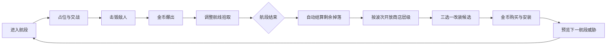

# 土豆兄弟式局内流程升级计划

**项目**：Knight on Air · 云端骑士  
**方案定位**：把《土豆兄弟》的“波次战斗 → 波末处理成长 → 商店购买 → 下一波”结构移植到移动端竖屏空战，并保持当前 5–12 分钟短局和飞机结构成长。解锁按波次编号推进，金币负责购买飞机改装，精英宝箱负责阶段性高价值奖励。  
**适用范围**：局内金币、精英宝箱、波次解锁、改装候选、波次结算、HUD 和验收。  

## 一、方案目标

这版计划只解决一局战斗内部的成长流程。局外机体解锁、永久升级、商店货币和结算奖励继续由现有存档与机库系统负责。

局内需要形成一条玩家可以反复理解的短循环。



玩家在战斗中解决空间问题，在波末窗口解决构筑问题。波次编号控制候选层级，金币决定当前能否购买，精英宝箱提供阶段性跃迁，改装结果决定下一航段的飞行方式。XP 不再承担购买资格或升级解锁职责。

## 二、与《土豆兄弟》的对应关系

| 《土豆兄弟》结构 | Knight on Air 方案 | 设计处理 |
|---|---|---|
| Wave | 航段 Wave | 保留波次概念，压缩为 12 波以符合 5–12 分钟短局 |
| 绿色材料 | 金币拾取物 | 击毁后爆出，拾取后进入本局余额 |
| 材料同时提供 XP 和 Gold | 金币进入本局余额 | 取消 XP 对购买和解锁的影响 |
| Level Up | 波末改装窗口 | 每波开放一次商店和改装选择 |
| 波末升级选择 | 波末三选一改装 | 继续使用现有合法候选和预览机制 |
| Shop | 改装商店 | 候选卡显示价格，确认安装时扣金币 |
| Shop Lock | 锁定候选 | 候选保留到下一波，最多锁定一项 |
| Reroll | 刷新候选 | 每波首次刷新低价，之后递增 |
| Wave-based item tier | 阶段候选层级 | 按波次编号解锁结构扩建和高风险武器 |
| Horde / Elite Wave | 增援或精英航段 | 在指定波次预告压力变化 |
| Boss Wave | 第 12 波 Boss | 结束时进入结算或继续模式 |

《土豆兄弟》的关键不是具体数值，而是把战斗收益和波末决策安排在同一条节奏线上。当前项目已经有金币拾取和改装价格，因此优先补齐航段结算、商店层级和精英宝箱即可接近这种结构。参考 [局内经济调查报告](IN_RUN_ECONOMY_RESEARCH.md)。

## 三、推荐的 12 波局内流程

12 波总时长约 9 分 15 秒。前 8 波逐步增加 5 秒，之后进入稳定长波，最后一波使用 75 秒 Boss 航段。它保留了《土豆兄弟》前期快速建立构筑、后期稳定承压的节奏，同时符合项目当前的短局目标。

| 波次 | 时长 | 威胁重点 | 商店层级 | 必要内容 | 升级体验 |
|---:|---:|---|---|---|---|
| 1 | 20 秒 | 低压追猎机，展示金币路线 | T1 | 基础敌群、金币、通用提质 | 第一次波末改装 |
| 2 | 25 秒 | 追猎机加交叉进入 | T2 | 增加移动方向变化 | 开放常规武器和系统强化 |
| 3 | 30 秒 | 第一个任务目标 | T2 | 主目标奖励预告 | 稳定当前构筑方向 |
| 4 | 35 秒 | 俯冲攻击机 | T3 | 进入方向提示 | 开放翼段和小型挂点 |
| 5 | 40 秒 | 第一组精英或增援 | T3 | 精英宝箱 | 争取第一次高价值跃迁 |
| 6 | 45 秒 | 轰炸拦截压力 | T3 | 轰炸模式教学复用 | 开放炸弹舱和稳定性 |
| 7 | 50 秒 | 护航或保护目标 | T3 | 主目标失败风险 | 开放装甲和维修相关卡 |
| 8 | 55 秒 | 高速截击机 | T4 | 高速换位和反追击 | 开放终局候选 |
| 9 | 60 秒 | 第二组精英 | T4 | 精英宝箱 | 提供高价构型或大额金币 |
| 10 | 60 秒 | 混合编组和路线压迫 | T4 | 增加火力密度 | 允许高价改装连续购买 |
| 11 | 60 秒 | Boss 前准备波 | T4 | 预告 Boss 目标层和抗性 | 消耗预算准备终局 |
| 12 | 75 秒 | Boss 与护卫 | T4 | 主目标击毁或返航 | 结算，或进入 Endless |

每波结束都打开改装窗口。第 12 波结束后不再生成普通商店，除非玩家选择 Endless 模式。

## 四、单波完整流程

### 4.1 波次开始

波次开始前显示以下信息。

- 当前波次和剩余时间
- 下一波主要敌人职责
- 是否存在精英、增援或 Boss
- 当前候选层级
- 当前金币和本波可购买层级
- 当前飞机构型的主要收益与代价

第 1 波使用固定开场敌群和少量金币路线，让玩家理解“击毁 → 爆金币 → 改变航向拾取”的闭环。后续波次沿用导演的固定种子和预算系统，不新增独立的战斗生成逻辑。

### 4.2 波次进行中

#### 敌人奖励

基础金币奖励绑定敌人击毁确认。命中只产生伤害、火花和连击反馈，持续伤害、爆炸和多炮位不会因为每次命中重复生成基础金币。

| 目标类型 | 基础金币 | 说明 |
|---|---:|---:|---|
| 普通敌机 | 2–4 | 生成 1–3 个金币碎片 |
| 高速或特殊敌机 | 4–7 | 生成 2–4 个金币碎片 |
| 精英敌机 | 10–16 | 生成 1 个大型金币和少量碎片 |
| 主目标 | 12–20 | 额外产生主目标完成事件 |
| Boss | 40–70 | 只在终局结算前发放 |

具体数值需要根据固定种子试玩调整。表格用于定义收入层级，不作为最终平衡值。

#### 金币拾取

金币在击毁位置散开，短时间内保留在世界中。玩家进入吸附半径后自动收集，收集时增加金币、分数和连击。波次结束时仍在场的金币进入“回收仓”，保留全部价值并在波末结算后计入余额，避免玩家因返航或轰炸任务被迫冲回危险区域。

金币实体需要继续使用现有拾取物池。建议增加以下配置字段。

```ts
interface CoinDropConfig {
  value: number;
  scatterRadius: number;
  life: number;
  magnetRadius: number;
  pickupRadius: number;
  comboValue: number;
}
```

#### 金币与升级资格

第一版移除 XP 对局内购买和解锁的作用。金币拾取只增加本局金币，波次结束时开放一次改装商店。玩家用金币购买当前波次已经解锁的改装，商店刷新和锁定也消耗金币。精英宝箱提供一次高价值改装或大额金币，作为普通商店之外的阶段性跃迁。

### 4.3 波次结束结算

波次倒计时结束后按固定顺序处理，顺序不能因为玩家处于空战、轰炸或返航而改变。

1. 停止敌人、投射物、风场、冷却、拾取物和任务计时。

2. 将场上未拾取金币转入回收仓，并把回收仓价值加入本局余额。

3. 结算本波主目标进度、击毁数、连击结束和分数。

4. 根据已完成波次开放本波商店层级，并生成三张合法改装候选。

5. 打开三选一改装候选。候选必须符合当前机体、当前构型、前置、互斥、商店层级和剩余挂点。

6. 玩家可以预览候选、锁定一项、刷新候选或返回战斗准备下一波。

7. 确认安装时扣除金币。安装完成后重新计算部件、挂点、质量、碰撞区域和操控参数。

8. 金币不足时仍可打开改装窗口查看候选层级和下一波威胁，但不能确认安装。

9. 玩家点击“开始下一波”或倒计时结束后，清空未锁定候选并启动下一波。

流程应复用现有 `phase = "upgrade"` 的暂停语义。后续若需要独立展示波末商店，可以新增 `intermission` 阶段，但不应让波末 UI 通过直接修改模拟状态绕过 `World`。

## 五、按波次推进的候选解锁

解锁采用《土豆兄弟》的波次规则。每波结束后进入商店和改装窗口，候选池根据刚完成的波次决定可出现的最高层级。波次越高，候选稀有度和结构复杂度越高。玩家不能通过在一波内绕圈等待提前解锁下一层，必须完成当前波次。

《土豆兄弟》中，商店 Tier 2 从第 2 波商店开始出现，Tier 3 从第 4 波商店开始出现，Tier 4 从第 8 波商店开始出现。Knight on Air 直接采用同一节奏映射。

| 层级 | 开放波次 | 候选方向 | 典型升级 |
|---|---|---|---|
| T1 | 第 1 波商店 | 基础提质和起手火力 | 快速供弹、额外散热器、低阻力短翼、强化弹药箱 |
| T2 | 第 2 波商店 | 常规武器和系统强化 | 左右机枪、冷却回路、稳定投放架、机头锁定雷达 |
| T3 | 第 4 波商店 | 结构变化和专门能力 | 左右翼延长机枪段、辅助发动机、炮塔、炸弹舱 |
| T4 | 第 8 波商店 | 高风险高收益构型 | 双侧动力组、重型装甲、翼尖发射轨、火箭巢、凝固汽油弹舱 |
| 精英奖励 | 精英宝箱 | 一次性高价值强化 | 终局结构、稀有武器、重复改装合并或大额金币 |

候选池必须先按波次层级过滤，再按机体、时代和构型合法性过滤。高层级候选不能在早期以低概率随机出现，否则波次解锁无法形成预期。当前 `src/data/upgrades.ts` 中已有的升级 ID 可以直接加入 `shopTier` 标签，避免复制一套升级数据。

每次三选一建议包含以下角色。

- 一张与当前已有标签协同的候选

- 一张改变飞机轮廓或火力位置的候选

- 一张低风险通用候选作为兜底

当合法唯一候选不足三张时，使用可重复的通用提质卡补足。不能出现三张都无法购买、无法安装或只因阶段锁定而失效的候选组合。

## 六、改装商店规则

### 6.1 购买

每次确认安装需要满足两个条件。

- 候选属于当前波次已经解锁的商店层级
- `coins >= upgradePrice(upgrade)`

确认时按以下顺序处理。

1. 再次验证候选仍属于当前合法池。
2. 再次验证金币和当前波次层级。
3. 扣除金币。
4. 应用结构和武器改装。
5. 更新候选、HUD、飞机模型和战斗统计。

如果安装动画或渲染加载失败，不能只扣除资源后进入下一波。安装状态和金币扣除应放在同一个世界状态提交点，失败时保留原构型和原余额。

### 6.2 锁定

每波最多锁定一张候选。锁定后下一波仍保留该卡，但候选层级升级后需要重新验证其前置和冲突关系。若新构型使其不再合法，系统应显示失效原因并返还锁定状态，不自动安装。

### 6.3 刷新

每波第一次刷新价格低，之后按本波刷新次数递增。建议起始价格为 2–4 金币，递增 1–3 金币。刷新后保留已锁定候选。

刷新必须使用当前候选池的种子和状态，确保固定种子下同一输入产生一致结果。不能因打开或关闭改装窗口而重置刷新价格或候选随机序列。

### 6.4 波末购买数量

玩家可以在一次波末窗口中连续购买多张升级，直到金币不足或主动返回战斗。这样保留《土豆兄弟》在同一商店内购买多个物品的决策感。

安装动画期间暂停所有购买输入。每次安装完成后刷新候选和余额，避免双击或快速按键重复消费。

## 七、建议的金币和价格曲线

以下数值用于第一轮固定种子试验。

| 波次 | 预计普通击毁数 | 预计金币收入 | 建议普通卡价格 | 建议结构卡价格 |
|---:|---:|---:|---:|---:|
| 1 | 4–6 | 10–18 | 6–8 | 未开放 |
| 2 | 5–8 | 14–24 | 6–10 | 未开放 |
| 3 | 6–9 | 18–30 | 8–12 | 12–16 |
| 4 | 7–10 | 22–36 | 8–14 | 14–18 |
| 5 | 8–12 | 28–46 | 10–16 | 16–22 |
| 6 | 8–13 | 30–50 | 10–18 | 18–24 |
| 7 | 9–14 | 34–56 | 12–20 | 20–26 |
| 8 | 10–15 | 38–62 | 12–22 | 22–30 |
| 9 | 10–16 | 42–70 | 14–24 | 24–34 |
| 10 | 11–17 | 46–76 | 14–26 | 26–38 |
| 11 | 12–18 | 50–84 | 16–28 | 30–42 |
| 12 | 12–20 | 60–100 | 18–32 | 34–50 |

数值目标不是让玩家每波都能买到最贵的卡。正常玩家应在前 4 波完成 2–4 次低价改装，在第 5–8 波完成 2–4 次结构改装，在第 9–11 波保存金币准备终局。Boss 波不再提供普通购买窗口，剩余金币进入结算统计。

## 八、HUD 与操作流程

### 8.1 战斗 HUD

战斗 HUD 增加或明确显示以下信息。

| 信息 | 显示方式 | 更新时机 |
|---|---|---|
| 本局金币 | 金币图标和余额 | 金币拾取、回收、购买 |
| 精英宝箱 | 宝箱图标和待领取状态 | 精英击毁、领取奖励 |
| 当前波次 | `WAVE 03 / 12` | 波次开始、结算 |
| 航段倒计时 | 进度条和秒数 | 固定步进更新 |
| 商店层级 | T1–T4 或中文层级名 | 波次开始、商店解锁 |
| 回收仓 | 波中显示待回收价值 | 波次结束清算 |

金币增加需要区分“爆出”“已吸附”和“已回收”。玩家看到敌机爆炸但余额没有立即增加时，HUD 应显示待拾取价值，避免误以为奖励丢失。

### 8.2 波末改装托盘

改装托盘继续占用战斗视口底部三分之一，保留上方战场和 HUD。建议从当前设计扩展以下内容。

- 波次结算标题，例如“第 05 波完成”
- 当前金币和待回收金额
- 当前波次和商店层级
- 三张候选卡
- 每张卡的价格、购买后余额、当前层级和前置条件
- 锁定、刷新、确认安装和返回战斗
- 下一波敌人职责和剩余准备时间

在轰炸模式进入波末改装时，返回战斗必须恢复轰炸模式、准心和剩余炸弹状态。现有 session lifecycle 规格已经要求升级完成后恢复进入升级前的战斗阶段，这条规则继续适用。

## 九、失败、暂停和边界处理

### 玩家死亡

死亡后不再进入新的波末购买窗口。已经确认安装的升级保留在结算构型中，未确认的预览、锁定候选和待回收金币按照结算规则处理。若金币已进入回收仓，应计入本局统计，不应因为死亡动画重复结算。

### 玩家主动返航

主动返航应先完成当前固定步进，再进入结算。返航不自动消费金币，也不打开波末商店。若产品未来允许返航前改装，需要明确它属于波末窗口还是独立的返航奖励窗口，不能在两处重复获得免费改装。

### 暂停和失焦

改装、暂停、帮助、设置和浏览候选期间，模拟时间必须停止。波末倒计时属于准备 UI，不应继续推进敌人、投射物、风场、金币寿命或轰炸冷却。

### 金币不足

金币不足时候选仍可预览。确认按钮显示缺口，不改变金币和飞机构型。玩家可以关闭托盘继续战斗，下一波继续使用已解锁层级。

### 候选不足

先从当前阶段的合法候选中过滤，再使用可重复通用卡补足。若连通用卡也不足，系统应显示稳定的兜底升级，而不是显示空卡或阻止下一波。

## 十、实现拆分计划

### 第 1 步，加入航段状态

新增或扩展运行状态字段。

```ts
interface RunStageState {
  wave: number;
  waveElapsed: number;
  waveDuration: number;
  shopTier: 1 | 2 | 3 | 4;
  pendingRecoveryCoins: number;
  rerollsThisWave: number;
  lockedUpgradeId?: string;
}
```

阶段配置放入数据文件，不把波次、时长和层级写死在渲染逻辑中。`World.frame()` 继续使用固定步进推进波次计时。

### 第 2 步，补齐波末结算事件

增加可被 HUD 和音频消费的事件。

- `wave_started`
- `wave_warning`
- `wave_completed`
- `coins_recovered`
- `shop_tier_unlocked`
- `intermission_opened`
- `intermission_closed`

事件只描述结果和显示数据。金币、精英宝箱、候选和飞机构型变更仍由 `World` 提交。

### 第 3 步，加入候选层级过滤

在升级数据中增加 `shopTier` 或等价字段。`legalUpgrades` 需要同时检查已完成波次、当前商店层级和现有构型。升级配置继续使用当前 ID、部件、挂点和武器引用，不新建 NPC 专用或展示专用结构。

### 第 4 步，扩展改装窗口

改装窗口支持连续购买、锁定、刷新、金币差额、当前层级和下一波预告。确认安装继续复用现有 `chooseUpgrade` 和结构重建流程，避免分叉出另一套飞机应用逻辑。

### 第 5 步，加入固定种子验证

为 12 波运行增加固定种子回归。验证 30、60 和 120 FPS 下，波次结束时间、金币数量、精英宝箱、候选顺序和飞机构型一致。

## 十一、OpenSpec 同步计划

实现前需要先更新以下行为契约。

| 文档 | 需要补充的内容 |
|---|---|
| `battle/in-run-progression` | 12 波流程、金币回收、波末结算、按波次解锁、精英宝箱和货币分层 |
| `battle/aircraft-refit` | 商店层级、连续购买、锁定、刷新、金币不足和合法兜底 |
| `battle/battle-hud-and-event-feedback` | 波次倒计时、金币待拾取、回收仓、商店层级和波末事件 |
| `battle/session-lifecycle` | 波末改装期间冻结模拟、主动返航和死亡时的结算边界 |
| `app/persistence-and-meta-progression` | 本局金币与结算奖励的分离显示和写入规则 |

OpenSpec 更新完成后，再修改 `src/data/config.ts`、`src/data/upgrades.ts`、`src/simulation/World.ts`、`src/simulation/types.ts`、`src/content/2d/BattleStatus.ts` 和相关样式。升级候选和飞机构型继续通过现有内容 ID、飞机工厂和局部锚点解析。

## 十二、首轮验收标准

1. 第 1 波持续 20 秒，结束后模拟冻结，玩家可以处理升级候选和金币购买。

2. 第 2 波持续 25 秒，波末商店开放 T2 候选，T2 之前的候选继续可购买。

3. 第 4 波商店开放 T3 候选，第 8 波商店开放 T4 候选，更高层级不能通过随机刷新提前出现。

4. 玩家在波末可以连续购买多张合法改装，直到金币不足或主动关闭窗口。

5. 金币由敌机击毁生成，单个敌机无论受到多少次命中都只生成一次基础金币奖励。

6. 波末未拾取金币进入回收仓并保留价值，玩家不会因为没有飞回掉落点而无提示损失收入。

7. 金币不足时确认安装被阻止，金币和飞机构型都不改变。

8. 连续购买两张升级时，每次安装都会更新金币、飞机结构、挂点和操控参数。

9. 候选刷新价格只在当前波次内递增，进入下一波后按配置重置。

10. 玩家在轰炸模式中打开波末改装，完成后恢复轰炸模式和准心状态。

11. 玩家暂停、失焦或打开帮助期间，波次时间、金币寿命、投射物、敌人和冷却全部停止。

12. 第 12 波 Boss 被击毁后进入结算，普通敌群和商店不再继续生成。

## 十三、推荐落地顺序

先实现 12 波状态、波末冻结和按波次解锁，再实现精英宝箱、连续购买、锁定和刷新，最后调金币价格、敌人收入和 Boss 奖励。XP 若保留，只作为可选的驾驶员基础属性成长，不参与商店购买资格。这样可以先验证波次节奏和商店经济，再决定是否需要恢复 XP 进度条。

最终流程可以压缩成一句产品规则。玩家在波内击杀敌人并承担拾取风险，在波末把战斗收益转换成飞机改装，在下一波用新的结构和操控特性解决更高的空战压力。

