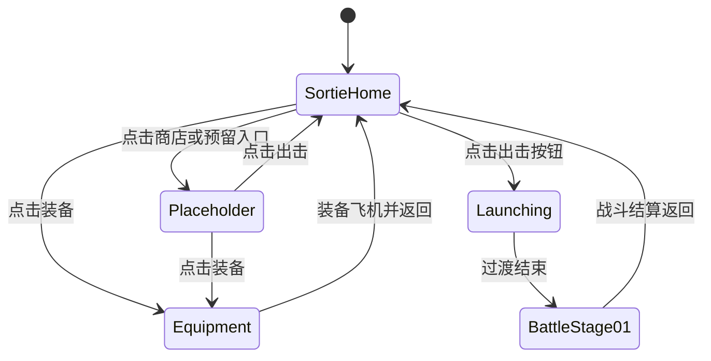

# 局外 UI 和主界面系统

> 本文记录 0.3.0 阶段的初版设计。当前实现见下列入口。[机库与展厅规格](../../openspec/specs/app/out-of-battle-hangar/spec.md) · [仓库内容库指导](../../AGENTS.md)

## 设计目标

局外界面负责让玩家快速完成三个动作。

1. 查看当前装备的飞机和构筑方向。
2. 选择要驾驶的飞机。
3. 点击出击进入第一关副本。

主界面本身是一个持续运行的 3D 展示场景。玩家当前装备的飞机一直朝屏幕上方飞行，飞机和背景保持低速运动，形成出击前的临场感。玩家不需要等待动画结束才能操作按钮。

## 页面结构

局外页面使用竖屏布局。

```text
┌─────────────────────────┐
│ 状态栏                   │
│                         │
│                         │
│        飞机朝上飞行      │  展示区
│   云层、地面、尾焰、部件  │
│                         │
│ 当前飞机信息             │
│       [ 出击 ]           │  主操作区
├─────────────────────────┤
│ 商店 │ 装备 │ 出击 │ 预留 │ 预留 │  底部切换栏
└─────────────────────────┘
```

### 局外展示区

- 占屏幕上方约 72% 到 78%
- 由 Three.js 透视相机渲染
- 相机位置固定在飞机后上方，飞机头部朝屏幕上方
- 飞机沿局外展示轨迹持续向前飞，世界地面和云层向下移动
- 飞机的发动机尾焰、部件轮廓和当前装备武器保持可见
- 轻微左右摆动和滚转用于表现飞行状态，不影响页面操作
- 玩家切换飞机后，展示场景在 0.4 到 0.7 秒内替换为新机体

### 状态栏

状态栏位于顶部安全区内，显示局外信息。

- 玩家头像或默认徽记
- 玩家等级和局外经验
- 当前拥有的金币或资源
- 音效、设置和帮助入口可以使用图标预留

状态栏的高度不超过屏幕高度的 8%，避免压缩飞机展示空间。第一版优先显示玩家等级和金币，其他内容可以保留图标位置。

### 当前飞机摘要

摘要卡位于展示区下方和出击按钮上方，内容跟随当前装备飞机变化。

- 机体名称
- 机体等级或解锁状态
- 当前生命、速度、加速度和转向率的简化条形显示
- 已安装的主要武器图标
- 部件数量或构筑标签

摘要卡只显示能够帮助玩家做出出击或换机决策的信息。完整部件列表在装备界面查看。

## 主界面

主界面对应底部导航中的出击页，也是进入游戏后的默认页。

### 飞行展示

飞机的默认方向是屏幕上方。局外展示场景使用固定透视相机，玩家看到飞机尾部、机翼、发动机和前方地面。

```text
aircraft.position.z += displayForwardSpeed * deltaTime
worldOffset.z -= displayForwardSpeed * deltaTime
cloudOffset.z -= cloudSpeed * deltaTime
```

当飞机移动到展示轨迹的前端时，通过世界循环或无缝地块替换保持连续飞行。飞机本身可以保持在屏幕下半部到中部之间，方便玩家观察机体和尾焰。

展示场景状态如下。

| 状态 | 飞机表现 | 页面用途 |
| --- | --- | --- |
| `idle` | 稳定向前飞行，轻微滚转 | 默认待机 |
| `selected` | 尾焰短暂增强，机体边缘高亮 | 刚切换飞机 |
| `preview` | 轻微减速，部件高亮 | 从装备页返回主界面 |
| `launching` | 加速、镜头拉近、云层加快 | 点击出击后的过渡 |
| `locked` | 停止按钮反馈，防止重复点击 | 正在进入副本 |

### 出击按钮

出击按钮位于主界面靠下位置，处于摘要卡和底部切换栏之间。

- 默认文案为“出击”
- 第一关未进入时显示“进入第一关”或“出击”
- 选择未解锁机体时，按钮保持可用但提示需要先解锁
- 点击后按钮进入短暂锁定状态，避免重复创建战斗场景
- 点击后播放 0.6 到 1.0 秒的加速过渡，再进入第一关副本
- 加速过渡期间飞机尾焰、云层速度和相机前视距离同步增加

第一版点击出击后直接进入第一关副本，不增加额外的关卡选择页。后续加入多个副本时，可以在出击按钮上方增加小型关卡卡片或滑动选择器。

## 底部切换栏

底部切换栏固定在安全区上方，高度建议为 72 到 88 CSS 像素。五个入口在一行等宽排列。

| 顺序 | 名称 | 初始状态 | 作用 |
| ---: | --- | --- | --- |
| 1 | 商店 | 预留 | 未来购买机体、外观或局外资源 |
| 2 | 装备 | 可用 | 查看和选择飞机、查看部件构筑 |
| 3 | 出击 | 可用，默认选中 | 返回主界面并进入第一关 |
| 4 | 预留一 | 预留 | 未来可放置任务、活动或图鉴 |
| 5 | 预留二 | 预留 | 未来可放置设置、成就或社交 |

### 导航表现

- 当前页面使用高亮底线、图标填充和轻微上浮表示
- 点击出击时直接回到主界面，不重复初始化当前飞机
- 点击装备时保留当前选择和滚动位置
- 点击商店或两个预留项时显示轻量占位页或“即将开放”状态
- 占位页仍保留底部切换栏，玩家可以立即返回出击或装备
- 页面切换使用 0.2 到 0.3 秒的横向淡入或轻推过渡

底部导航的触控区域需要覆盖完整按钮盒，最小高度为 48 CSS 像素。图标和文字必须同时存在，避免只依赖图标猜测功能。

## 装备界面

装备页用于选择飞机和查看当前机体的结构、武器与构筑标签。

### 页面布局

```text
┌─────────────────────────┐
│ 装备                     │
│                         │
│       3D 飞机预览        │
│                         │
│  [上一架]  机体名称 [下一架]│
│                         │
│  速度  加速  转向  生命   │
│  当前武器和部件           │
│       [装备这架飞机]      │
├─────────────────────────┤
│ 商店 │ 装备 │ 出击 │ 预留 │ 预留 │
└─────────────────────────┘
```

### 飞机选择

第一版可以使用横向滑动卡片或左右箭头选择飞机。3D 预览使用独立透视相机，展示飞机的前方、侧面和顶部轮廓。

- 已解锁飞机可以直接点击选择
- 当前装备飞机显示“当前装备”状态
- 未解锁飞机显示解锁条件和半透明轮廓
- 预览状态可以查看参数，但不会改变主界面的当前飞机
- 点击“装备这架飞机”后，当前飞机写入局外存档
- 装备成功后返回主界面或保留在装备页，由按钮文案明确提示

第一版默认点击装备后返回主界面，让玩家立即看到新飞机继续向上飞行。若玩家正在浏览多个飞机，可以连续预览而不改变实际出击飞机。

### 机体信息

装备页显示完整的基础信息。

- 机体名称和定位标签
- 生命、极速、加速度、转向率和能量
- 机身长度、翼展和迎弹面等级
- 默认武器和当前安装武器
- 已安装部件的位置缩略图
- 部件损坏系统的说明入口

参数条使用统一刻度，方便比较不同机体。数值变化使用颜色和箭头表示，不能只依赖柱状图的长度。

### 构筑预览

3D 预览支持部件高亮。

- 点击武器图标，高亮对应挂点和炮管
- 点击发动机图标，高亮发动机和尾焰
- 点击左右翼图标，高亮翼展、碰撞范围和预计转向影响
- 点击机头或机尾图标，高亮机身长度和对应惯性影响
- 处于损坏状态的部件使用灰黑色和轻微烟雾提示

装备页中的部件状态来自局外保存的构筑。局内战斗中的临时损坏在结算后恢复为可出击状态，第一版不把一局战斗中的损坏永久带入下一局。

## 商店和预留页

### 商店预留

商店入口可以打开占位页，页面显示即将开放的商品区域轮廓。第一版不提供购买流程，避免影响装备和出击闭环。

### 预留一和预留二

两个预留入口使用独立占位配置，允许后续直接替换页面内容。

```ts
type MetaTabConfig = {
  id: 'shop' | 'equipment' | 'sortie' | 'reservedA' | 'reservedB'
  label: string
  icon: string
  state: 'active' | 'placeholder'
  route: string
}
```

预留页不应在实现阶段写死具体业务名称。它们只保存图标、文案和路由位置，未来可以变成任务、图鉴、活动、成就、设置或社交页。

## 局外状态

```ts
type MetaState = {
  activeTab: MetaTabConfig['id']
  equippedAirframeId: string
  selectedPreviewAirframeId: string
  unlockedAirframeIds: string[]
  unlockedUpgradeIds: string[]
  firstMissionUnlocked: boolean
  bestScore: number
  playerLevel: number
  currency: number
}
```

### 页面进入规则

- 首次进入游戏默认打开出击页
- `equippedAirframeId` 无效时自动装备第一架初始机体
- 进入装备页时预览当前装备飞机
- 选中其他飞机只改变预览，点击装备后才改变出击机体
- 从战斗结算返回时回到出击页并展示当前装备飞机
- 点击出击时读取 `equippedAirframeId` 创建第一关战斗场景

## 页面状态机



页面状态和战斗状态分开管理。局外页面不会直接操作战斗世界，出击按钮通过 `BattleSessionFactory` 用当前装备数据创建新的战斗会话。

## 主界面展示性能

- 飞机展示使用与战斗相同的程序化模型和 shader 参数
- 只保留一架玩家飞机和少量装饰云层、地面块和粒子
- 世界循环不创建持续增长的对象，使用地块复用
- 浏览器页面切入后台时降低展示场景更新频率
- 进入装备页时暂停主界面展示场景，但保留当前飞机数据
- 返回主界面时从保存的飞机状态恢复展示，不重复生成全部几何体

## 验收标准

- 打开游戏后默认看到当前飞机持续朝屏幕上方飞行。
- 飞机展示使用透视相机和 3D lowpoly 几何体。
- 底部切换栏包含商店、装备、出击和两个预留入口。
- 出击页默认选中，出击按钮位于页面靠下且高于底部导航。
- 装备页可以浏览、预览和装备已解锁飞机。
- 点击出击后直接进入第一关副本。
- 商店和两个预留入口具备可返回的占位页。
- 页面切换和飞机选择不会破坏当前装备状态。
